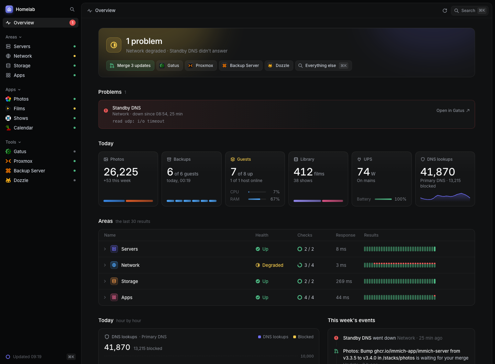

# Overlook

[](https://github.com/bnlqn/overlook/actions/workflows/ci.yml)
[](https://github.com/bnlqn/overlook/releases/latest)
[](LICENSE)

Your whole homelab on one page, laid out for you.

[](https://bnlqn.github.io/overlook/)

What's wrong, how each area of the homelab is, and what it did today and
this week, on a page that is the same for every homelab. Overlook reads
the tools you already run and changes nothing. If you
[turn on MCP](#agents-through-mcp), your AI agent can ask it what the page
shows, and can't change anything either.
[See the demo](https://bnlqn.github.io/overlook/), drawn from a homelab
that doesn't exist.

It reads:

- **Check engines**: [Gatus](#gatus), [Uptime Kuma](#uptime-kuma),
  [Grafana](#grafana), [Prometheus and Alertmanager](#prometheus-and-alertmanager),
  [Checkmate](#checkmate)
- **Servers**: [Proxmox VE](#proxmox-ve), [Beszel](#beszel),
  [Docker](#docker), [Portainer](#portainer), [NUT](#nut)
- **Network**: [UniFi Network](#unifi-network), [AdGuard Home](#adguard-home),
  [Pi-hole](#pi-hole), [Nginx Proxy Manager](#nginx-proxy-manager)
- **Storage**: [Proxmox Backup Server](#proxmox-backup-server),
  [Syncthing](#syncthing), and the pools, storage and backup runs of
  [Proxmox VE](#proxmox-ve)
- **Apps**: [Immich](#immich), [Jellyfin](#jellyfin), [Emby](#emby),
  [Plex, through Tautulli](#plex-through-tautulli), [Radarr](#radarr),
  [Sonarr](#sonarr), [Prowlarr](#prowlarr), [qBittorrent](#qbittorrent),
  [Seerr](#seerr), [Home Assistant](#home-assistant),
  [Paperless-ngx](#paperless-ngx), [Nextcloud](#nextcloud), [Gitea](#gitea),
  [Forgejo](#forgejo)
- **Chores**: [GitHub](#github), [iCalendar to-do lists](#icalendar-to-do-list)

What it can't read, and why, is under [Can't be read](#cant-be-read).

## What it shows

- **What's wrong**: the problems, which are the checks your check engine
  alerts on, for as long as they fail. Overlook runs no check and sends no
  alert, so the page and your alerts always agree.
- **How each area is**: Servers, Network, Storage and Apps, each up,
  degraded (a problem, but it still works, such as DNS with one of two
  resolvers down) or down, with its checks' last 30 results and a page of
  its own with what its sources add, such as a host's guests or a
  resolver's top clients.
- **Today**: a figure from each source, such as guests up, DNS lookups,
  photos or what the UPS draws.
- **This week**: each area's problems and events along the last seven days,
  and the list of what happened, as far as your sources remember it.
- **Your apps and tools**, each a link with a dot that says whether it
  answers.
- **The chores**: the ones on your to-do list that are due or come this
  week, the updates waiting for your merge or to be installed, the
  batteries to change, the devices waiting to be adopted and the requests
  waiting for your approval. You do a chore where it waits, such as
  marking it done on the list, never on the page, and a chore is never a
  problem.

The page is light where your system is light, and dark otherwise. On a
phone, your browser's Add to Home Screen, or Install app, puts it there as
an app of its own.

It reads without colour or a mouse too. A failed result stands taller than
a passed one, in forced colours as well. A screen reader says each state
that a glyph or a dot shows, and a check's last results in words, such as
28 of 30 passed and the last one failed at 14:02, which the keyboard shows
on each row it reaches.

## What it never does

- **It never changes anything.** Overlook sends a source only GET requests,
  and a login where a source offers no other way in, which changes nothing
  but a session; it sends NUT only LIST VAR, which reads. The client it
  reads with refuses every other request. Some keys it holds could do
  anything (AdGuard Home has no read-only users, and Radarr's and Sonarr's
  keys are admin keys), and this is what keeps them harmless. Tautulli
  changes things on GET too, and Gitea and Forgejo for a few paths, so
  their adapters send only the commands and paths that read, from a list
  their tests check (ADR 0011).
- **It never runs a check or sends an alert.** Your check engine does both.
- **It remembers nothing.** No database and no volume: it reads every
  source when the page asks, at most every 30 seconds, so an Overlook
  nobody looks at sends nothing into your homelab. What happened this week
  is what your sources remember.
- **It never sends a key to the browser.** The server reads every source
  and gives the page a snapshot of what it read, never a key or a source's
  own answer, and gives an agent no more, if you [turn MCP on](#agents-through-mcp).
- **It never asks where to put things.** The page is fixed: your config
  says which sources fill it, never where anything goes. There are no
  widgets to arrange.
- **It never calls anywhere you didn't name.** No telemetry and no update
  check; the page's fonts, icons and manifest come from Overlook itself.

## Quick start

Overlook is one container. Give it a folder of its own for its config,
beside a `compose.yaml`:

```
overlook/
compose.yaml
```

```yaml
# compose.yaml
services:
  overlook:
    image: ghcr.io/bnlqn/overlook:0.6
    restart: unless-stopped
    ports:
      - "8080:8080"
    volumes:
      - ./overlook:/etc/overlook:ro # the config and its keys, read-only: Overlook writes nothing
    environment:
      TZ: Europe/Brussels           # when today starts
    read_only: true                 # Overlook writes nothing,
    cap_drop: [ALL]                 # needs no Linux capability,
    security_opt: ["no-new-privileges:true"] # and can gain none
```

Then `docker compose up -d`, and open port 8080 of that host. With no
config yet, Overlook shows its setup page. It asks first for the code
Overlook wrote in its log as it started, which
`docker compose logs overlook` shows, so that only someone who can read
the log can set it up. Then pick the tools your homelab runs, give each
its address and key, and try it. From the sources that
answered, the setup page puts together two files, `overlook.yaml` and the
`.env` that holds their keys. Save both in `overlook/`, then
`docker compose restart`, and the setup page, still open, turns into the
page. A source that didn't answer its try says what to do about it, such
as for a certificate Overlook doesn't trust. The log says which sources
Overlook reads, and the page names any that didn't answer.

The two files look like this, and you can write them yourself instead:

```yaml
# overlook/overlook.yaml
sources:
  gatus:
    - url: http://gatus.example.com:8080
  proxmox:
    - url: https://pve.example.com:8006
      token: overlook@pve!overlook
      secret: ${PROXMOX_SECRET}       # from .env
      ca: /etc/overlook/pve-root-ca.pem # copied into overlook/

apps:
  - name: Photos
    url: https://photos.example.com
    icon: immich.svg
    check: Photos
```

```sh
# overlook/.env: the keys
PROXMOX_SECRET=00000000-0000-0000-0000-000000000000
```

- **Keys come from `.env`**, beside the config, or from Overlook's
  environment, which wins. A `${VAR}` anywhere in the config is read from
  either, so the config holds no secret and can be shared or kept in git,
  while `.env` stays out of it. A `${VAR}` set in neither stops Overlook,
  and says which. `.env` holds a `NAME=value` a line, the value all that
  follows the first `=`, with no quotes taken off, so a key holding `#` or
  a quote stays whole; a line that starts with `#` is a comment.
- **The config is mounted read-only**, at `/etc/overlook`, with a CA file or
  your own icons beside it. The image runs as uid 65532, so the folder and
  its files must be readable by others, as they are by default. To keep
  `.env` from everyone else on the host, give it to that user:
  `sudo chown 65532 overlook/.env && sudo chmod 600 overlook/.env`.
- **The setup page is there only while there is no `overlook.yaml`.** A
  config that is there but wrong, an empty one too, stops Overlook, and
  says why. While the setup page is up, it reads an address only for
  someone who gives it the code from the log, a new one each time Overlook
  starts, as [SECURITY.md](SECURITY.md) says.
- **`TZ`** says when today starts, for today's figures. Any zone works: the
  zone database is inside the binary.
- **The image** is `ghcr.io/bnlqn/overlook`, for amd64 and arm64: `0.6` for
  the newest 0.6 release, or a version such as `0.6.0`. It holds the
  binary and the CA certificates it checks HTTPS sources with, and nothing
  else.

Without Docker, each [release](https://github.com/bnlqn/overlook/releases)
has the binary for Linux on amd64 and arm64, such as for an LXC container
or a Raspberry Pi:

```bash
overlook -config /etc/overlook/overlook.yaml -listen :8080
```

It reads `.env` beside the config there too, and shows the setup page until
the config exists, with the code it asks for in the log, on standard error.

On Unraid, install Overlook from the Apps tab, where
[its listing](https://ca.unraid.net/apps/overlook-0zkg6r11kddp7t) is:
search for Overlook, and apply its template. Its config folder is
`/mnt/user/appdata/overlook`, it runs locked down as above, and Unraid
gives it `TZ` itself. Its WebUI opens the setup page, which says where
Unraid shows the code from the log, and how to save the two files there.
To link the Unraid server itself in the sidebar, as a tool, give it
`icon: unraid.svg`, which Overlook ships.

On Home Assistant OS, Overlook installs as an app, which Home Assistant
called an add-on until 2026, and opens in its sidebar: in Settings, Apps,
App store, add `https://github.com/bnlqn/overlook` to its repositories,
install Overlook, and open it from the sidebar, which shows the setup page:
the code it asks for is on the app's Log tab.
Its config folder is the one Home Assistant gives it in `app_configs`,
mounted read-only, and Home Assistant gives it `TZ` itself.
[The app's documentation](homeassistant/DOCS.md), on its Documentation tab
too, says how to save the two files there, and how to open Overlook outside
the sidebar, such as for MCP.

## Configuring

[`overlook.example.yaml`](overlook.example.yaml) shows every source with
comments. Overlook reads the config once, at start, and refuses a key it
doesn't know, so a typo stops it rather than going unnoticed.

**Sources.** Under `sources:`, each adapter has a list, so two AdGuard Home
resolvers are two entries under `adguard:`. Each source has a `name`, which
the page uses. Each adapter gives one, such as Gatus, and two sources can't
share one, so two of one adapter need names of their own. With two of one
adapter, the page names each one's sections, figures and events, and adds up what
adds up, such as two Proxmox hosts' guests, split by source.
What each adapter reads, its config and the least key it needs are under
[Adapters](#adapters) below.

**Areas.** The page has four, always the same: Servers, Network, Storage
and Apps, and an area with nothing in it isn't shown. Each adapter puts
its parts in its own area, such as Proxmox VE in Servers and AdGuard Home
in Network, but stores and backup runs go in Storage whichever adapter
reads them, such as Proxmox VE's ZFS pools and its nights' backups, each
looking the same whatever its source. A check goes in the area its group
in the check engine is named after, or the one the config gives that
group, as in Gatus's `areas:`. A check in no area still counts, and its
problems still show.

**Apps and tools.** Apps are what the homelab hosts for the people who use
it; tools are what you run it with. Both are links on the page, in the
sidebar and in ⌘K:

```yaml
apps:
  - name: Photos                     # the only key besides url it needs
    url: https://photos.example.com
    icon: immich.svg                 # a file in overlook/icons/, one Overlook ships, or a URL
    check: Photos                    # the check that lights its dot
    description: The family's photos
    color: "#ED79B5"                 # tints its tile
tools:
  - name: Proxmox
    url: https://pve.example.com:8006
    icon: proxmox.svg
    check: Hypervisor
```

A `check` is a check's name in your check engine. With two check engines
that both have a check of that name, say which, as `Gatus Outside/Photos`;
if you don't, the dot shows the worse of the two, and the log says so once.

Overlook ships icons for a few common apps (`web/icons`); a file of the
same name in `icons/` beside the config wins over one of them.

**Chores** are what you do while nothing is broken: the ones you keep on a
to-do list, which the [iCalendar](#icalendar-to-do-list) source reads; the
updates waiting for your merge, which the [GitHub](#github),
[Gitea](#gitea) and [Forgejo](#forgejo) sources read;
the updates waiting to be installed, which the
[Home Assistant](#home-assistant), [Nextcloud](#nextcloud) and
[UniFi](#unifi-network) sources read, the batteries to change, from Home
Assistant, and the devices waiting to be adopted, from UniFi; and the
requests waiting for your approval, which the [Seerr](#seerr) source reads.
The page lists the chores due, from their day on, and those in the coming
week, by the viewer's own calendar; with none, it says which is next. With
chores from more than one source, each is named by the one it waits in. You
add, change and mark chores done in your to-do app or from a script, and do
the others where they wait, never on the page (ADR 0010), and the page
follows within 30 seconds.

**MCP.** `mcp: true` lets an AI agent read what the page shows, as
[Agents, through MCP](#agents-through-mcp) says. It's off until you turn
it on.

**Flags.** `-config` names the config (`overlook.yaml` by default), and
`.env`, `icons/` and `custom.css` are read beside it; `-listen` is the address to
serve the page on (`:8080`).

## Adapters

Each adapter reads the sources of one program. More come by pull request from
people who run them ([CONTRIBUTING.md](CONTRIBUTING.md)).

### Gatus

A check engine: every check, its last results and the problems Gatus
remembers. A check is a problem once it fails as many times in a row as
your alerts wait for, and stops being one when it passes.

```yaml
sources:
  gatus:
    - url: http://gatus:8080            # where Overlook reads Gatus
      link: https://status.example.com  # where the page sends you, if not the same
      threshold: 3                      # failures in a row that make a problem: as your alerts
      areas:                            # where a group not named like an area goes
        DNS: network
        Backups: storage
```

**Key:** none, as Gatus's API is open unless you protect it. If yours asks
for a login, as Gatus's `security.basic` does, give it as `user` and
`password`: `user: overlook` and `password: ${GATUS_PASSWORD}`.

**Areas:** a group named like an area, such as Servers or network, puts its
checks there. `areas` says where each other group goes, and a group it
doesn't name is in no area. **Threshold:** set it to your alerts'
`failure-threshold` (3 unless you changed it), so a problem on the page is
one your alerts announced.

### Uptime Kuma

A check engine, as Gatus is: each monitor on one of its status pages, its
last 30 results and the problems they remember. A monitor is a problem once
Uptime Kuma calls it down, after the retries you gave it, which is when it
alerts; while it retries, the page shows it failing.

```yaml
sources:
  uptimekuma:
    - url: http://uptime-kuma:3001     # where Overlook reads Uptime Kuma
      page: homelab                    # the status page's slug, as in /status/homelab
      link: https://uptime.example.com # where the page sends you, if not the same
      areas:                           # where a group not named like an area goes
        DNS: network
```

**Key:** none, as a status page is public: Overlook reads the monitors on the
one you name, and no others. Make one for it in Status Pages, with each
monitor in a group named like an area, such as Servers or Network, or one
`areas` places, as Gatus's groups are. Uptime Kuma gives a monitor's results
only there and over its socket.io, after a login, which Overlook doesn't
speak.

A status page doesn't say why a monitor failed, so the page doesn't either.
Nor does it say how many retries a monitor has: the page counts them from
the last time the monitor went down, in the 100 results a status page keeps,
and for a monitor that hasn't gone down there, it says how many times in a
row it failed, but not how many make a problem.
Uptime Kuma serves a status page's results a minute at a time.

Recorded from a scratch Uptime Kuma 2.5.8 with invented monitors (ADR 0008),
until someone who runs one records it from theirs: the compose file and the
scripts that fill and record it are in the adapter's
[`testdata`](internal/adapters/uptimekuma/testdata).

### Grafana

A check engine, as Gatus is: each alert rule Grafana manages, in the area
its folder is named after, or the one `areas` gives, with its last 30
evaluations and the problems its state history remembers this week. A rule
is a problem once it fires, or while its query gives no data or an error,
which Grafana alerts on too; while it's pending, the page shows it failing,
and how many evaluations its pending period holds.

```yaml
sources:
  grafana:
    - url: http://grafana:3000          # where Overlook reads Grafana
      token: ${GRAFANA_TOKEN}
      link: https://grafana.example.com # where the page sends you, if not the same
      areas:                            # where a folder not named like an area goes
        Hosts: servers
```

**Key:** a service account's token, with the role **Viewer**, which reads
alert rules and their history and changes nothing. In Administration, Users
and access, Service accounts, add one with that role, then add it a token.

Grafana keeps only when a rule's state changed, not each evaluation, so the
page draws each of the last 30 from those changes at the rule group's
interval. Overlook reads each rule's history with a request of its own.
Alert rules kept in a Prometheus or Loki data source, rather than by Grafana
itself, are left out: the [Prometheus](#prometheus-and-alertmanager) adapter
reads Prometheus's own.

Recorded from a scratch Grafana 13.3 with invented alert rules over its own
test data (ADR 0008), until someone who runs one records it from theirs: the
compose file and the scripts that fill and record it are in the adapter's
[`testdata`](internal/adapters/grafana/testdata).

### Prometheus and Alertmanager

A check engine, as Gatus is: each of Prometheus's alerting rules, in the
area its group is named after, or the one `areas` gives, with its last 30
evaluations, from the history Prometheus keeps of its alerts, and its
problems this week. A rule is a problem while it fires; while it's pending,
the page shows it failing, and how many evaluations its `for` holds. With
Alertmanager read too, a rule all of whose alerts Alertmanager silences or
inhibits isn't a problem, since Alertmanager sends no alert for it: the page
shows it failing, with the silence's comment.

```yaml
sources:
  prometheus:
    - url: http://prometheus:9090              # where Overlook reads Prometheus
      alertmanager: http://alertmanager:9093   # its Alertmanager, if any
      link: https://prometheus.example.com     # where the page sends you, if not the same
      areas:                                   # where a rule group not named like an area goes
        node: servers
```

**Key:** none, as Prometheus's and Alertmanager's APIs are open unless you
protect them. If yours ask for a login, as `basic_auth_users` in Prometheus's
web config does, give it as `user` and `password`, the same for both.
Overlook reads the rules, two range queries of the `ALERTS` series and
Alertmanager's alerts and silences, all with GET, which change nothing.

This week's problems are read to five minutes, which a week of firing
alerts holds in a few thousand samples.

Recorded from a scratch Prometheus 3.15 and Alertmanager 0.34 with invented
alert rules over numbers of their own (ADR 0008), until someone who runs
them records it from theirs: the compose file, the rules and the scripts
that fill and record it are in the adapter's
[`testdata`](internal/adapters/prometheus/testdata).

### Checkmate

A check engine, as Gatus is: each monitor Checkmate checks, in the area its
group is named after, or the one `areas` gives, with its last 30 results
and the problems its incidents remember this week. A monitor is a problem
once Checkmate calls it down, when enough of the last checks in its status
window failed, which is when it alerts; until then, the page shows it
failing, and how many failures in a row make a problem, 3 at the window's
5 checks and 60%. A hardware or Docker monitor is a problem too while
Checkmate calls it breached, over a threshold you gave it: its results fail
for as long, with what crossed it.

```yaml
sources:
  checkmate:
    - url: http://checkmate:52345         # where Overlook reads Checkmate
      user: overlook@example.com          # its user's email
      password: ${CHECKMATE_PASSWORD}
      link: https://checkmate.example.com # where the page sends you, if not the same
      areas:                              # where a group not named like an area goes
        DNS: network
```

**Key:** a login, as `user` and `password`, since Checkmate has no API
keys. Overlook logs in with one POST, keeps the token in memory and sends
it with each GET, logging in again when Checkmate refuses it, after the 99
days it lasts unless you changed `TOKEN_TTL` (ADR 0009). The least it needs
is a user of its own with the role **User**, which reads every monitor and
its incidents, and can pause, change or delete none. As the super admin, in
your account's Team, use Add member to make one with that role.

A monitor you paused is left out, as Checkmate neither checks it nor alerts
on it. One in a maintenance window isn't a problem either, for the same
reason: the page shows its last results from before the window, failing if
it was failing then. Checkmate lists a hardware monitor with its newest
check alone, so Overlook reads each one's last 30 with a request of its
own. A published status page could be read without a login, but it doesn't
say which group a monitor is in, so nothing would place its checks in an
area.

Recorded from a scratch Checkmate 3.13.1 with invented monitors, and a
Capture agent 1.4.0 for its hardware monitors (ADR 0008), until someone who
runs one records it from theirs: the compose file and the scripts that fill
and record it are in the adapter's
[`testdata`](internal/adapters/checkmate/testdata).

### GitHub

The updates waiting: the open pull requests Dependabot or Renovate opened on
the repositories you list. They are chores, never problems.

```yaml
sources:
  github:
    - repos: [example/homelab, example/website]
      token: ${GITHUB_TOKEN} # only for private repositories
      # bots: ["dependabot[bot]", "renovate[bot]"] # whose pull requests are updates
      # url: https://github.example.com/api/v3     # a GitHub Enterprise Server's API
```

**Key:** none for public repositories. For private ones, a
[fine-grained token](https://github.com/settings/personal-access-tokens/new)
with read-only access to **Pull requests** on those repositories (GitHub adds
**Metadata** itself). Without one, GitHub answers 404 for a private
repository.

Overlook reads GitHub at most every 10 minutes, so an update can take that
long to show. Without a token GitHub allows 60 requests an hour from your
address, and each read is one request per repository: ten repositories hold,
fewer if something else at your address reads GitHub without a token.

### iCalendar to-do list

The chores you keep on a to-do list, read from the iCalendar file a CalDAV
server gives for a GET, such as Radicale, Nextcloud or Baïkal. Edit the list
in any app that syncs it, such as Reminders on an iPhone, Tasks.org with
DAVx⁵ on Android, or Thunderbird, or from a script over CalDAV.

```yaml
sources:
  ical:
    - url: https://dav.example.com/owner/chores/ # the list, as Radicale serves it
      user: owner                                # a login, if the server asks for one
      password: ${DAV_PASSWORD}
      # name: Chores                             # what the page calls it, if you keep more than one list
```

On Nextcloud or Baïkal the `url` is the list's CalDAV address with `?export`
at the end, such as
`https://cloud.example.com/remote.php/dav/calendars/owner/chores/?export`.

A to-do's title is the chore and its description the note. Its due date is
the day it's due from, a time counting as its day, and one with no due date
is due now. One marked done or cancelled leaves the page. A to-do that comes
back is your app's to move on when you mark it done, and Overlook reads only
the next due date.

**Key:** a login that can read the list, as `user` and `password`, sent by
HTTP's basic authentication, or none if the list is open. Overlook only ever
sends it with GET (ADR 0001). The least it needs, on Radicale, is a user of
its own with only `i` on the list, which lets it GET the list and nothing
else. With Radicale's rights from a file (`[rights] type = from_file`), beside
the sections that give each user their own:

```ini
[overlook]
user: overlook
collection: owner/chores
permissions: i
```

Baïkal asks for Digest unless its admin page sets Basic, which Overlook needs.
Recorded from Radicale; Nextcloud and Baïkal give the same iCalendar for
`?export`, but haven't been recorded.

### Immich

The photos, on the Apps page: what each person keeps and uploaded this week,
the space they take on Immich's disk, Immich's version and whether a newer one
is out, and the jobs queued. Today's figure is everyone's photos and videos,
with each person's share of the room they take.

```yaml
sources:
  immich:
    - url: http://immich:2283
      key: ${IMMICH_KEY}
      # name: Photos # what the page calls it, if not Immich
```

**Key:** an API key made by an admin (Account Settings, API Keys), since
Immich shows everyone's photos, the queues and each person's uploads only to
an admin. Give it only these six read permissions:

- `server.statistics`: each person's photos, videos and space
- `server.storage`: the disk the photos are on
- `server.about`: Immich's version
- `server.versionCheck`: the newest version released
- `queue.read`: the jobs queued
- `adminUser.read`: what each person uploaded this week

What each person uploaded needs Immich 3 or later; an older one leaves it out.

### Proxmox Backup Server

One datastore, in Storage: how full it is, its nights as backup runs, and
each guest's newest backup in it, with when it was made, its size, and
whether it passed its check, named by its notes, which Proxmox VE fills
with the guest's name. A night is the backups made one after another, so
PBS says when it started and how many backups it made, but not when it
ended. Today shows how many guests the last night backed up, each guest
blue where it did, and the week each night's backup run. The last night is
the run with the most guests in the day to the newest backup, so a guest
backed up by hand after it doesn't hide it.

```yaml
sources:
  pbs:
    - url: https://pbs.example.com:8007
      token: overlook@pbs!overlook
      secret: ${PBS_SECRET}
      datastore: backups
      ca: /etc/overlook/pbs.pem         # PBS's own certificate, copied from the server
      # server_name: pbs.example.com    # the name it's for, if the url uses another
```

**Key:** an API token with the role **DatastoreAudit** on that datastore,
which lists the backups and can't read them. A token can do no more than
its user, so both get the role. On the server:

```bash
proxmox-backup-manager user create overlook@pbs
proxmox-backup-manager acl update /datastore/backups DatastoreAudit --auth-id overlook@pbs
proxmox-backup-manager user generate-token overlook@pbs overlook
proxmox-backup-manager acl update /datastore/backups DatastoreAudit --auth-id 'overlook@pbs!overlook'
```

The third command prints the token's secret. The same role reads how full
the datastore is.

**Certificate:** PBS signs its own, for its own name. Copy
`/etc/proxmox-backup/proxy.pem` from the server beside Overlook and name it
as `ca`. If the `url` reaches PBS by an address its certificate doesn't
name, give the name it does as `server_name`. As for Proxmox VE, there is
no way to skip the check.

The backups were recorded from a PBS 4, with every name and number made up.
How full the datastore is was recorded from a scratch PBS 4.2.9 (ADR 0008),
until someone who runs one records it from theirs: the compose file and the
scripts that fill and record it are in the adapter's
[`testdata`](internal/adapters/pbs/testdata).

### Syncthing

One Syncthing device, in Storage: each folder, up to date with what it
holds, syncing or out of sync with what it still needs, paused, or in red
when items failed to sync or the folder stopped, with why; then each other
device, connected or since when it isn't, and how much of what it shares it
has; Syncthing's version and whether a newer one is out; and its errors, in
red, until you clear them in its GUI. Each device asking to connect and
each folder offered to it is a chore, from the day it asked, done where
Syncthing asks you to accept or ignore it.

```yaml
sources:
  syncthing:
    - url: http://syncthing:8384        # where Overlook reads its GUI
      key: ${SYNCTHING_KEY}
      link: https://sync.example.com    # where the page sends you, if not the same
```

**Key:** the API key, from Actions, Settings, GUI. It's the only key
Syncthing has, and it can do anything, but Syncthing changes things only
with POST, PUT, PATCH and DELETE, and Overlook sends it only with GET
(ADR 0001). Overlook reads the folders and devices from the config, but
never the whole config, which holds the GUI's password and the key.

The GUI must listen where Overlook can reach it, as in Syncthing's Docker
image; a Syncthing installed on its own listens on `127.0.0.1:8384` until
you set its GUI's listen address to `0.0.0.0:8384`. With its GUI over HTTPS,
give its certificate, `https-cert.pem` in its config folder, as `ca`, and the
host's name, which it is for, as `server_name`.

Syncthing's Docker image, and most distributions' packages, are built
without upgrades, and refuse to say whether a newer one is out, so the page
shows only the version they run. Overlook reads each folder's state and each
device's completion with a request of its own.

Recorded from a scratch Syncthing 2.1.7, four devices with invented folders
(ADR 0008), until someone who runs it records it from theirs: the compose
file and the scripts that fill and record it are in the adapter's
[`testdata`](internal/adapters/syncthing/testdata).

### Proxmox VE

Each host's processor, memory, uptime and version, and the guests, in
Servers, with each host's processor and memory by the hour over the week
Proxmox keeps, a line each. The ZFS pools and the storage go in Storage, as
every source's stores do: how full each is, and each pool's health, in red
when it isn't ONLINE, as is a storage Proxmox VE can't reach. So do the
backup runs: each host's last run, and the week each run. A storage on a
Proxmox Backup Server that Overlook reads too shows once, as that server's
datastore. Today shows how many guests are up.

```yaml
sources:
  proxmox:
    - url: https://pve.example.com:8006 # any host of a cluster reads all of it
      token: overlook@pve!overlook
      secret: ${PROXMOX_SECRET}
      ca: /etc/overlook/pve-root-ca.pem  # Proxmox's own CA, copied from the host
```

**Key:** an API token of a user with the role **PVEAuditor**, which reads
everything and changes nothing. On the host:

```bash
pveum user add overlook@pve
pveum acl modify / --users overlook@pve --roles PVEAuditor
pveum user token add overlook@pve overlook --privsep 0
```

The last command prints the token's secret. The user has no password, so
the token is the only way in, and it can do no more than the user.

**Certificate:** Proxmox signs its own. Copy `/etc/pve/pve-root-ca.pem` from
the host beside Overlook and name it as `ca`: Overlook then trusts that CA
alone for this source. There is no way to skip the check, since a key sent
to whoever answers in Proxmox's place is given away. A host with a
certificate from a public CA, such as Let's Encrypt, needs no `ca`.

### Radarr

The films on disk and the room they take, the films added this week, what
Radarr is downloading and warns about, and the films out to stream or on
disc in the next seven days. Its home area is Apps. With Sonarr read too, the
films and shows share one tile in Today, the library, split by the room each
takes.

```yaml
sources:
  radarr:
    - url: http://radarr:7878 # where Overlook reads Radarr
      key: ${RADARR_KEY}
      name: Radarr            # if you run more than one, tell them apart
```

**Key:** Radarr's API key, from Settings, General. It's the only key Radarr
has, and it can do anything, but Overlook sends it only with GET requests,
which change nothing (ADR 0001).

Radarr answers with every film at once, so Overlook reads the films at most
every 10 minutes, and a film can take that long to count. The rest is read
with every snapshot.

### Sonarr

The shows and episodes on disk and the room they take, the episodes imported
this week, what Sonarr is downloading and warns about, and the episodes that
air in the next seven days. Its home area is Apps. With Radarr read too, its
shows share the library's tile with the films.

```yaml
sources:
  sonarr:
    - url: http://sonarr:8989 # where Overlook reads Sonarr
      key: ${SONARR_KEY}
      name: Sonarr            # if you run more than one, tell them apart
```

**Key:** Sonarr's API key, from Settings, General. Like Radarr's, it's the
only key and it can do anything, and Overlook sends it only with GET requests
(ADR 0001).

The shows are read at most every 10 minutes, as Radarr's films are.

### NUT

A UPS, read from NUT's upsd over NUT's own protocol. Servers shows whether it
runs on mains or on its battery, its model and the voltage it's fed, the
battery's charge and how long it would last, and what its load draws; the
overview shows the draw and the battery.

```yaml
sources:
  nut:
    - host: nut.example.com # upsd, as host or host:port (3493 unless you say)
      ups: ups              # the UPS's name in upsd, as in its ups.conf
```

upsd needs no login for this: Overlook sends only `LIST VAR` for the UPS
named, and has no code to send any other command.
upsd must listen where Overlook can reach it, which by default it doesn't:
set `MODE=netserver` in `nut.conf`, add a `LISTEN` line for the address
Overlook reaches to `upsd.conf` (such as `LISTEN 192.0.2.13 3493`), and let
Overlook through any firewall to that port. The readings cross the network
unencrypted, as upsd sends them without TLS.

### UniFi Network

Each UniFi OS console, such as a Cloud Gateway, a Dream Machine or UniFi OS
Server, and every site on it, in Network. First the internet: each WAN, how
long it has been up, how much of the last day it answered and how fast, or
since when it's down, and the last speed test. A WAN down since the gateway
started, as a spare port with nothing in it is, is grey while another is
up; one that drops is red. Then each device, the gateway, switches and
access points: how long it has been up and how busy its processor and how
full its memory are, or its state, offline in red and interrupted in orange.
Today shows the clients connected, wired, wireless and on the VPN, every
console's added up, in orange while a device or a WAN is down. A device
offline isn't a problem, since Overlook runs no check: give it a check in
your check engine to make it one. The chores are each device whose firmware
waits, a gateway's being UniFi OS itself, each device waiting to be adopted,
and the Network application's update.

```yaml
sources:
  unifi:
    - url: https://unifi.example.com
      key: ${UNIFI_KEY}
      ca: /etc/overlook/unifi.pem    # the console's own certificate
      server_name: unifi.local       # the name it's for
```

**Key:** an API key, from the Network application's **Integrations**:
**Create New API Key**, with **Never Expires**. UniFi has no read-only key,
so it could change anything on the console, every site and device; what
keeps it harmless is that Overlook only ever sends GET (ADR 0001). It needs
UniFi OS and Network 10.0 or later.

**Certificate:** the console signs its own, for `unifi.local`, and Overlook
never reads a source it can't check. Save it with
`openssl s_client -connect unifi.example.com:443 </dev/null | openssl x509 >unifi.pem`,
give it as `ca` and name `unifi.local` as `server_name`. When the console
makes a new one, every two years or so, save it again. With a certificate
of your own on the console, you need neither.

**Two reads nothing documents.** UniFi's documented API says nothing of the
WANs or of the Network application's update, so Overlook reads them from
the API before it, with the same key and a GET too. Ubiquiti changes that
one without warning: when a change breaks a read, the Internet section or
that chore goes missing, and the rest stays, until the adapter is recorded
again. UniFi's history isn't read: its events come only from a POST, and
its traffic by the hour from a read that Network 11 has only just moved.

Recorded from the maintainer's Cloud Gateway Fiber, on UniFi OS 5.1.34 with
Network 10.6.109, with every name, ID and MAC address made up; its
[`record.sh`](internal/adapters/unifi/testdata/record.sh) records yours.

### AdGuard Home

Each resolver is its own source. Today's lookups and blocks show on the
Overview, every resolver's added up, hour by hour. The Network page charts
them by the hour over the hours every resolver keeps, added up too, then shows
each one: whether it blocks, its lookups, blocks and upstreams, how fast it
answers and its version, and its top clients, domains and blocked domains,
over the interval its statistics keep. The Overview's lookups turn orange
while a resolver doesn't block.

```yaml
sources:
  adguard:
    - name: Primary DNS
      url: http://dns1.example.com
      user: overlook
      password: ${ADGUARD_PASSWORD}
    - name: Standby DNS
      url: http://dns2.example.com
      user: overlook
      password: ${ADGUARD_PASSWORD}
```

**Key:** a login, as `user` and `password`. AdGuard Home has no
read-only users, so that login could change anything; what keeps it
harmless is that Overlook only ever sends GET (ADR 0001). Give Overlook a
user of its own: add it under `users:` in `AdGuardHome.yaml`, with its
password hashed by `htpasswd -B -C 10 -n -b overlook <password>`, and
restart AdGuard Home.

**Today** starts at midnight in Overlook's time zone: set `TZ`, such as
`TZ=Europe/Brussels`, in its container. AdGuard Home keeps statistics by
the hour for an interval of up to 7 days; over a longer one it keeps them
by the day, in UTC, and the Overview shows no figure for it.

### Pi-hole

A resolver, as AdGuard Home is: each one is its own source, and its lookups
add up with every other resolver's, AdGuard Home's too, on the Overview and
in the Network page's chart, hour by hour over the last day, which is all
Pi-hole keeps in memory, so beside a resolver that keeps a week, the chart
shows the day they both have. Then each one, as any resolver: whether it
blocks, or is paused and until when, its lookups, blocks and upstreams; then
its blocklists and when they were last updated, what it warns about, such
as a client it rate-limits, its version and whether a newer one is out; and
its top clients, domains and blocked domains.

```yaml
sources:
  pihole:
    - name: Kids' DNS
      url: http://pihole.example.com
      password: ${PIHOLE_PASSWORD}
```

**Key:** an app password, from Settings, Web interface / API, in expert
mode: **Configure app password**. Pi-hole gives a session only for a login,
so Overlook logs in with one POST, keeps the session in memory and sends it
with each GET, logging in again only when Pi-hole forgets it (ADR 0009). An
app password logs in without the second factor, if you set one, and Pi-hole
has no read-only one, so it could change anything; what keeps it harmless is
that Overlook sends nothing else. With no password set in Pi-hole, leave
`password` out. Each Overlook keeps one of the sessions Pi-hole allows, 16
unless you changed `webserver.api.max_sessions`.

Recorded from a scratch Pi-hole 2026.10 with invented clients and domains
(ADR 0008), until someone who runs one records it from theirs: the compose
file and the scripts that fill and record it are in the adapter's
[`testdata`](internal/adapters/pihole/testdata).

### Nginx Proxy Manager

One Nginx Proxy Manager, in Network: each proxy host, redirection, 404 host
and stream, with where it sends what it receives, grey while it's disabled,
and in red when nginx refused its config, with what nginx said, since
Nginx Proxy Manager then serves nothing for it; and its version and whether
a newer one is out. Then the certificates they serve, the one that ends
first first, in orange within 30 days of its end, and red once it has
ended. A certificate within 30 days is a chore too, done in Nginx Proxy
Manager's Certificates: one from Let's Encrypt is renewed from 30 days
before its end, so one still within them isn't renewing.

```yaml
sources:
  npm:
    - url: http://npm:81                # where Overlook reads its admin
      user: overlook@example.com        # its user's email
      password: ${NPM_PASSWORD}
      link: https://npm.example.com     # where the page sends you, if not the same
```

**Key:** a login, as `user` and `password`, since Nginx Proxy Manager has
no API keys. Overlook logs in with one POST, keeps the token in memory and
sends it with each GET, logging in again once it lapses, after a day
(ADR 0009). The least it needs is a user of its own: in Users, add one
without Administrator, then, in its Permissions, give it All Items under
Item Visibility, so that it sees the hosts you made, and View Only on Proxy
Hosts, Redirection Hosts, 404 Hosts and Streams. Leave Certificates and
Access Lists hidden: each host brings the name and end of the certificate
it serves, while Nginx Proxy Manager's list of certificates gives whoever
may view it the private key of every certificate you uploaded. Overlook
can't answer a second factor, so give its user none.

Nginx Proxy Manager doesn't check whether what a host sends to answers, so
a host pointing at nothing looks like any other: your check engine says
whether it answers. A stream pointing at a name that doesn't resolve is
refused by nginx, and shows in red. A certificate no host serves is left
out. Nginx Proxy Manager asks GitHub whether a newer one is out, and when it
can't, the page shows no version.

Recorded from a scratch Nginx Proxy Manager 2.16.0 with invented hosts and
self-signed certificates (ADR 0008), until someone who runs one records it
from theirs: the compose file and the scripts that fill and record it are
in the adapter's [`testdata`](internal/adapters/npm/testdata).

### Beszel

Each system Beszel's agents report on, as a host, in Servers: how long it
has been up, its threads and load, and how busy its processor and how full
its memory and disk are, or since when it's down. Its processor and memory
by the hour, over the week Beszel keeps, are a line each on the same charts
as any other source's hosts, such as Proxmox's. Today shows the hosts up,
every hub's added up.

```yaml
sources:
  beszel:
    - url: http://beszel:8090         # where Overlook reads the hub
      user: overlook@example.com      # its user's email
      password: ${BESZEL_PASSWORD}
```

**Key:** a login, as `user` and `password`, since Beszel has no API keys.
Overlook logs in with one POST, keeps the session in memory and sends it
with each GET, logging in again when Beszel forgets it (ADR 0009). The least
it needs is a user of its own with the role **readonly**, which can change
nothing, nor read the agents' keys. As a superuser, in the hub's admin page
at `/_/`, add the user to the `users` collection with `role` set to
`readonly`, then add it to the `users` of each system to show, or set
`SHARE_ALL_SYSTEMS=true` on the hub so that every user sees every system.

### Docker

Each container a Docker engine runs, in Servers: its image, and whether it
runs, those that exited with an error, restart or fail their health check
in red or orange, and one that exited cleanly, as a job does when it's
done, in grey. Today shows the containers running, every engine's added up.

```yaml
sources:
  docker:
    - url: http://socket-proxy:2375 # Docker's API, through a socket proxy
      name: Media                   # if you run more than one engine, tell them apart
```

**Key:** none, as Docker's API has no login and no read-only access:
whoever reaches its socket is root on the host, even through a socket
mounted read-only. So Overlook reads it only through a socket proxy that
lets the containers' reads through and refuses the rest, over HTTP: it has
no way to read Docker's socket itself, nor Docker's API over TLS. With
[linuxserver's socket proxy](https://docs.linuxserver.io/images/docker-socket-proxy/),
beside the containers on each host:

```yaml
services:
  socket-proxy:
    image: lscr.io/linuxserver/socket-proxy:3.4.7
    environment:
      CONTAINERS: "1" # the containers' reads; every write stays refused
    volumes: ["/var/run/docker.sock:/var/run/docker.sock:ro"]
    read_only: true
    tmpfs: [/run]
    ports: ["2375:2375"] # where Overlook reaches it: keep it from anyone else
```

Overlook reads only the list of containers, never a container's own
details, which hold its environment and so its keys.

### Portainer

Each environment Portainer manages, in Servers: down in red, with when
Portainer last saw it, or its containers running, of all, in orange while
one fails its health check, and its stacks, whoever started them; then
Portainer's version, and whether a newer one is out. Today's containers add
up with every Docker engine's, and those of an environment that's down
don't count.

```yaml
sources:
  portainer:
    - url: https://portainer:9443      # where Overlook reads Portainer
      key: ${PORTAINER_KEY}
      ca: /etc/overlook/portainer.pem  # Portainer's own certificate
      server_name: localhost           # the name it's for
```

**Key:** an access token of a user of Overlook's own. As an administrator,
add the user in Users, not as an administrator, and give it only the
environments to show, in each one's Manage access; then log in as it, and
add the token in My account, Access tokens. The token never expires.
Portainer CE has no role that only reads, so that user could change
containers in those environments; what keeps it harmless is that Overlook
sends only GET requests (ADR 0001). On Portainer Business, give it the
role **Read-only user**. Overlook reads only the list of environments and
Portainer's version, never a container through Portainer, whose answer
holds its environment and so its keys.

**Certificate:** Portainer signs its own, on port 9443, for `localhost`.
Save it with
`openssl s_client -connect portainer.example.com:9443 </dev/null | openssl x509 >portainer.pem`,
give it as `ca` and name `localhost` as `server_name`. With a certificate of
your own, or Portainer over HTTP on port 9000, you need neither.

The counts come from the snapshot Portainer takes of each environment,
every five minutes unless you changed it in Settings, so a container can
take that long to count. An Edge agent's environment is up while the agent
calls Portainer. A Kubernetes environment shows only whether it's up.

Recorded from a scratch Portainer CE 2.45.3 managing two Docker engines with
invented containers (ADR 0008), until someone who runs one records it from
theirs: the compose file and the scripts that fill and record it are in the
adapter's [`testdata`](internal/adapters/portainer/testdata).

### Prowlarr

Each indexer, on the Apps page: whether it's enabled, those Prowlarr leaves
out because they fail, in red with since when, and what each was asked and
grabbed this week; and what Prowlarr warns about.

```yaml
sources:
  prowlarr:
    - url: http://prowlarr:9696 # where Overlook reads Prowlarr
      key: ${PROWLARR_KEY}
```

**Key:** Prowlarr's API key, from Settings, General. Like Radarr's, it's the
only key and it can do anything, even read each indexer's own key, and
Overlook sends it only with GET requests (ADR 0001).

### qBittorrent

The torrents, on the Apps page: how many download and seed and how fast,
the room left on qBittorrent's disk, whether peers can reach it, and each
torrent in error, with where it's saved. Today shows the torrents
downloading, every qBittorrent's added up.

```yaml
sources:
  qbittorrent:
    - url: http://qbittorrent:8080 # where Overlook reads its web UI
      key: ${QBITTORRENT_KEY}
```

**Key:** from qBittorrent 5.2, an API key, from Options, WebUI. It can do
anything the web UI can, and Overlook sends it only with GET requests
(ADR 0001). Before 5.2 there are no keys: give the web UI's login as `user`
and `password` instead, and Overlook logs in with one POST, keeps the
session in memory and sends it with each GET, logging in again only when
qBittorrent forgets it (ADR 0009). A wrong password is tried once a read,
so qBittorrent bans Overlook's address after five, for an hour unless you
changed it. With neither, qBittorrent must let Overlook in without a login,
as its bypass for whitelisted subnets does for Overlook's address.

The list of every torrent, which gives the counts and the room left, is
megabytes for a thousand torrents, so Overlook reads it at most every 10
minutes. The speeds, the connection and the torrents in error are read with
every snapshot.

### Jellyfin

The films, shows and music, on the Apps page: what each person plays now
and how, as it is, transcoded or paused; how many films, shows, albums and
books there are; the room left on each disk the libraries are on; the failed
logins of the last day; and each task whose last run failed, such as a
library's scan, in red with why. Today shows the plays since midnight, hour
by hour, every Jellyfin's added up.

```yaml
sources:
  jellyfin:
    - url: http://jellyfin:8096 # where Overlook reads Jellyfin
      key: ${JELLYFIN_KEY}
```

**Key:** an API key, from the dashboard's API Keys. It's the only kind
Jellyfin makes, and it can do anything an administrator can, but Overlook
sends it only with GET requests, which change nothing (ADR 0001).

Recorded from a scratch Jellyfin 12.4 filled with invented films and people
(ADR 0008), until someone who runs one records it from theirs: the compose
file and the scripts that fill and record it are in the adapter's
[`testdata`](internal/adapters/jellyfin/testdata).

### Emby

The films, shows and music, on the Apps page: what each person plays now
and how, as it is, transcoded or paused; how many films, shows, albums and
books there are; the failed logins of the last day; and each task whose last
run failed, such as a library's scan, in red with why. Today shows the plays
since midnight, hour by hour, every media server's added up.

```yaml
sources:
  emby:
    - url: http://emby:8096 # where Overlook reads Emby
      key: ${EMBY_KEY}
```

**Key:** an API key, from the dashboard's Advanced section, API Keys. It's
the only kind Emby makes, and it can do anything an administrator can, but
Overlook sends it only with GET requests, which change nothing (ADR 0001).

Recorded from a scratch Emby 4.10 filled with invented films and people
(ADR 0008): the compose file and the scripts that fill and record it are in
the adapter's [`testdata`](internal/adapters/emby/testdata).

### Plex, through Tautulli

Plex, on the Apps page, as Tautulli watches it: what each person plays now
and how, as it is, transcoded or paused, and the bandwidth it takes, of it
to remote players; each library, by what it holds; whether a newer Plex is
out, when Tautulli knows; and, in red, a Plex server Tautulli can't reach.
Today shows the plays since midnight, hour by hour, every media server's
added up, Jellyfin's and Emby's too.

```yaml
sources:
  tautulli:
    - url: http://tautulli:8181 # where Overlook reads Tautulli, directly
      key: ${TAUTULLI_KEY}
      # name: Plex              # what the page calls it, if not Plex
```

**Key:** Tautulli's API key, from Settings, Web Interface, with the API on.
It's the only key Tautulli has, and it can change Tautulli **even through a
GET**: every command of Tautulli's API is one, such as
`delete_all_history`, so the GET-only client can't keep this key harmless.
What does is that the adapter sends only five commands, each of which
reads, from one list in its code that its test checks (ADR 0011). Tautulli
takes the key only in the address, so a proxy in front of it may log the
key: let Overlook reach Tautulli directly, as above.

Recorded from a scratch Tautulli 2.18 watching a scratch Plex 1.43, with
invented films and plays (ADR 0008), until someone who runs one records it
from theirs: the compose file and the scripts that fill and record it are
in the adapter's [`testdata`](internal/adapters/tautulli/testdata).

### Seerr

The requests for films and shows, on the Apps page: how many wait for your
approval, how many are on their way and how many are there, the problems
people reported that are still open, in orange, and whether a newer Seerr
is out or it waits for a restart. Each request waiting for approval is a
chore, from the day it was made, by its title and who asked, a link to its
page in Seerr, where you approve or decline it.

```yaml
sources:
  seerr:
    - url: http://seerr:5055             # where Overlook reads Seerr
      key: ${SEERR_KEY}
      link: https://requests.example.com # where the page sends you, if not the same
```

**Key:** Seerr's API key, from Settings, General. It's the only key Seerr
has, and it can do anything an administrator can, approving requests too,
but Overlook sends it only with GET requests, which change nothing
(ADR 0001).

A request names its film only by its number on TMDB, so Overlook reads each
title once from Seerr and keeps it, a title never changing; the 20 newest
requests waiting are listed.

Recorded from a scratch Seerr 3.5 with invented people asking for
public-domain films (ADR 0008), until someone who runs one records it from
theirs: the compose file and the scripts that fill and record it are in the
adapter's [`testdata`](internal/adapters/seerr/testdata).

### Home Assistant

The home, on the Apps page: Home Assistant's version, or whether it started
in safe or recovery mode; its automations, those that ran today and those
whose config it couldn't load, which never run, in red; and each device that
dropped off, the newest first. The updates it waits to install are chores,
each a link to its page of updates, as are the batteries below 20%.

```yaml
sources:
  homeassistant:
    - url: http://homeassistant:8123   # where Overlook reads Home Assistant
      token: ${HOMEASSISTANT_TOKEN}
      link: https://home.example.com   # where the page sends you, if not the same
```

**Key:** a long-lived access token of a user of Overlook's own that isn't an
administrator. As an administrator, add the user in Settings, People, Users,
with **Administrator** off; then log in as it, and make the token in its
profile's Security tab. A user that isn't an administrator can still use
every device, such as unlocking a door, with a POST, but Overlook sends only
GET requests, which change nothing (ADR 0001). It reads `/api/config` and
`/api/states`, which `default_config` turns on.

### Paperless-ngx

The documents, on the Apps page: how many Paperless-ngx keeps and how many
wait in its inbox, the room left on its disk, each part it runs on that
isn't well, such as its search index or its task queue, as it words why,
and each document it failed to take in, in red with why, until it's
dismissed in Paperless-ngx. Today shows the documents and the inbox.

```yaml
sources:
  paperless:
    - url: http://paperless:8000 # where Overlook reads Paperless-ngx
      token: ${PAPERLESS_TOKEN}
```

**Key:** the API token of a user of Overlook's own, which sees no document.
Paperless-ngx shows the parts' health and everyone's failed tasks only to
staff, so as a superuser, in Settings, Users & Groups, add a user with
**Admin** on and **Superuser** off, and give it only two permissions: View
on tasks and View on global statistics (`view_paperlesstask` and
`view_global_statistics`). Then make its token, as the user, from its
profile, or with
`curl -X POST -d username=overlook -d password=… https://paperless.example.com/api/token/`.
It can see no document and change nothing, and Overlook sends it only with
GET requests.
Overlook asks for the API's version 10, so that a newer Paperless-ngx answers
it the same way.

Recorded from a scratch Paperless-ngx 3.3.4 filled with invented letters
(ADR 0008), until someone who runs one records it from theirs: the compose
file and the scripts that fill and record it are in the adapter's
[`testdata`](internal/adapters/paperless/testdata).

### Nextcloud

The files, on the Apps page, from Nextcloud's serverinfo app: how many files
there are, of how many people, and how many used Nextcloud since yesterday;
the shares, by link and without a password; the room left and the
database's size; and its version, whether a newer one is out, or, in red,
whether it's in maintenance. Each app waiting for an update is a chore, a
link to Nextcloud's page of updates. Today shows the files, and who used it.

```yaml
sources:
  nextcloud:
    - url: http://nextcloud             # where Overlook reads Nextcloud
      token: ${NEXTCLOUD_TOKEN}
      link: https://cloud.example.com   # where the page sends you, if not the same
```

**Key:** serverinfo's own token, which reads serverinfo's answer and nothing
else, not even a file. Serverinfo ships with Nextcloud; set its token with
`occ`, as Nextcloud's own user:

```bash
occ config:app:set serverinfo token --value "$(openssl rand -hex 24)"
occ config:app:get serverinfo token
```

The counts are Nextcloud's background jobs', so they move as often as its
cron runs, every five minutes if you set it up so.

Recorded from a scratch Nextcloud 35.0.2 with invented people and files
(ADR 0008), until someone who runs one records it from theirs: the compose
file and the scripts that fill and record it are in the adapter's
[`testdata`](internal/adapters/nextcloud/testdata).

### Gitea

The updates waiting, as GitHub's are: the open pull requests Renovate
opened on the repositories you list, chores, never problems. Then, with an
administrator's token, the Actions runners, on the Apps page, in red when
one is offline; and each run that failed this week on those repositories,
in red among the week's events, by its workflow, its repository and the
commit or pull request that started it.

```yaml
sources:
  gitea:
    - url: http://gitea:3000             # where Overlook reads Gitea
      repos: [example/homelab, example/website]
      token: ${GITEA_TOKEN}              # for the runners and private repositories
      # bots: [renovate]                 # whose pull requests are updates
```

**Key:** an access token of an administrator, since only one can read the
runners, from Settings, Applications, with only two scopes, both that read:
**read:repository** and **read:admin**. It never expires. Without a token,
Overlook reads public repositories only, and no runners.

Gitea and Forgejo take a few GETs that change something, as Tautulli does:
Forgejo answers one with a runner's registration token, making one if there
is none, even for a token that only reads, and anyone with it can register
a runner of their own, which then runs the jobs and sees their secrets. So
the GET-only client can't keep this key harmless on its own: what does is
that the adapter sends only three paths, each of which reads, from one list
in its code that its test checks (ADR 0011).

Renovate on Gitea runs as a user you made for it: name that user in `bots`
unless it's `renovate`. Overlook reads the first 50 open pull requests and
the first 50 failed runs of each repository, with a request of its own for
each.

Recorded from a scratch Gitea 28.3.0 with two act_runner 0.6.1 runners and
invented repositories and pull requests (ADR 0008), until someone who runs
one records it from theirs: the compose file and the scripts that fill and
record it are in the adapter's [`testdata`](internal/adapters/gitea/testdata).

### Forgejo

As [Gitea](#gitea), which Forgejo was forked from and which it still
answers like: the updates waiting, as GitHub's are; the Actions runners,
in red when one is offline; and the runs that failed this week.

```yaml
sources:
  forgejo:
    - url: http://forgejo:3000           # where Overlook reads Forgejo
      repos: [example/homelab]
      token: ${FORGEJO_TOKEN}            # for the runners and private repositories
      # bots: [renovate]                 # whose pull requests are updates
```

**Key:** as Gitea's: an administrator's access token, from Settings,
Applications, with only **read:repository** and **read:admin**. Forgejo
answers a GET for a runner's registration token, which is why the adapter
sends only the paths on its list (ADR 0011).

Recorded from a scratch Forgejo 17.0.1 with two Forgejo Runner 13.2.1
runners, filled as Gitea's is (ADR 0008), until someone who runs one
records it from theirs: the compose file and the scripts that fill and
record it are in the adapter's
[`testdata`](internal/adapters/forgejo/testdata).

### Can't be read

These tools can't be read the way Overlook reads, with GET (ADR 0001), one
login (ADR 0009) and, for a source that changes things on GET, a fixed list
of reads (ADR 0011), or are left out on purpose. Each names the decision it
runs into, and none gets an adapter until that changes:

- **Backrest and restic**: restic has no API, every call to Backrest's is a
  POST, and its metrics say how the last backup went, not when (ADR 0001).
- **Caddy**, on purpose: its admin API has no login, and its only lock is a
  TLS client certificate, so opening it to Overlook opens it to anyone there
  to rewrite Caddy's config (ADR 0001).
- **Deluge, Transmission, Komodo and Zabbix**: every read is a POST
  (ADR 0001).
- **Dockge**: it speaks only socket.io (ADR 0001).
- **Plex on its own**, on purpose: its token is your whole Plex account,
  other servers and friends too, so Overlook reads Plex through
  [Tautulli](#plex-through-tautulli) (ADR 0011).
- **Synology DSM**: its only documented login is a GET with the password in
  the address, where logs keep it, and how to read its health isn't
  documented (ADR 0009).
- **TrueNAS**: TrueNAS 27 removes the REST API, which leaves only a
  WebSocket (ADR 0001).
- **Unbound**: its statistics come only from `unbound-control`, over TLS
  with a client certificate, or on the same machine (ADR 0001).
- **Vaultwarden**, on purpose: reading more than its version takes the
  admin token, which can delete every user (ADR 0009).

Others are left out for a reason of their own:

- **Dozzle and Authelia**: they show nothing more than whether they answer,
  which a check already says.
- **Readarr**: retired in June 2025.
- **The UniFi Network application on its own**, without UniFi OS: it has
  no API keys, and Ubiquiti dropped it in Network 11, for UniFi OS Server,
  which [UniFi](#unifi-network) reads.
- **Watchtower**: no longer kept, and archived in December 2025.

## No login

Overlook has no accounts and no login: anyone who can open the page sees
all of it. It never shows a key, but it does show your hosts, names and
what is wrong. Keep it on your LAN or behind your VPN, or put it behind
your reverse proxy's own authentication, such as forward auth to your
identity provider.

Behind a login, let `/apple-touch-icon.png` through it, and only that: an
iPhone adds the page to its home screen without your login, so it asks
for the icon there, and shows a letter if it gets the login page instead.
It is Overlook's logo and nothing more.

## Agents, through MCP

An AI agent can read what the page shows, if you turn it on. Overlook then
answers the Model Context Protocol at `/mcp`, at the page's own address,
with no login, as the page has none, so whoever can open the page can read
it there too:

```yaml
# overlook/overlook.yaml
mcp: true
```

Restart Overlook, and give your agent that address as an MCP server over
HTTP, such as `http://overlook.example.com:8080/mcp`. With Claude Code,
that is
`claude mcp add --transport http overlook http://overlook.example.com:8080/mcp`.

- **It can only read.** It has six tools, one for each part of the page,
  and none of them changes anything, in Overlook or in your homelab:
  `problems` (what's wrong, the homelab's state and each area's, and
  whether each source answered), `area` (one area and its state, as its
  own page shows it), `today` (the figures), `this_week` (the problems and
  events of the last seven days), `chores` (the chores and the updates)
  and `apps_and_tools` (each link, its state and the check that says
  whether it answers). Every state is the one the page shows.
- **It reads the snapshot and nothing else**: the one the page is drawn
  from, at most 30 seconds old, never a key or a source's own answer. Each
  tool returns its part as JSON, each message key with its English words
  beside it and its values next to them, never a sentence Overlook put
  together itself.
- **The model behind the agent sees your homelab**: its hosts, names and
  problems, wherever that model runs. That is why MCP is off until you
  turn it on.
- **A website can't reach it.** It refuses a request from a page in your
  browser that isn't Overlook's own, so that a site you visit can't read
  your homelab through you.
- It speaks MCP's current revision, 2026-07-28, and the three before it,
  2025-11-25, 2025-06-18 and 2025-03-26, which many agents still speak. It
  answers each request on its own and whole, with nothing streamed
  (ADR 0015).

## Your own look

A `custom.css` beside the config is loaded after the page's own
stylesheet, so it can change any colour, size or font:

```css
/* overlook/custom.css */
:root {
  --m-accent-2: #3cad4b;   /* the accent, green */
  --m-content-max: 1400px; /* a wider page */
}
```

The page's colours, sizes and fonts are the `--m-` properties at the top
of [`web/style.css`](web/style.css): the dark page's, then the light
page's, under `@media (prefers-color-scheme: light)`. A property your
custom.css sets changes both; set under the same `@media`, it changes the
light page only. The page stays one page: custom.css changes how it looks,
not what it shows.

## Translating

The page speaks the language of your browser when someone has translated
it, and English for any word a translation lacks. A translation is one
file; [CONTRIBUTING.md](CONTRIBUTING.md#translating) says how.

## What's next

`v0.6.0` is the newest release, and [the releases](https://github.com/bnlqn/overlook/releases)
say what each one brought. The road to v0.7 takes Overlook where more
homelabs are, as [selfh.st's 2025 survey](https://selfh.st/survey/2025-results/)
counts them, and keeps it sound as they come:

1. [x] A Home Assistant add-on, kept here beside Unraid's template, so
       that Overlook installs inside Home Assistant OS, which three
       homelabs in ten run, and opens in its sidebar.
2. [ ] The next tools by how many homelabs run them, each recorded from a
       scratch instance (ADR 0008), one pull request each, each run by
       about one homelab in five:
       [Nginx Proxy Manager](https://github.com/bnlqn/overlook/issues/77),
       [Audiobookshelf](https://github.com/bnlqn/overlook/issues/78) and
       [Traefik](https://github.com/bnlqn/overlook/issues/79).
3. [ ] Two translations or more, each kept by someone who speaks it
       (ADR 0006), and the page looked at in each, at desktop and phone
       width, for words longer than English's.
4. [x] A check's results readable without colour or a mouse: its last 30
       said in words, such as 28 of 30 passed and the last one failed at
       14:02, for a screen reader and the keyboard, and a failed result
       told from a passed one by more than red and green. Then the page is
       gone through with a screen reader and in forced colours, and what
       doesn't read is fixed.
5. [x] The setup page asks for a code from the log before its first try,
       so that no website can have it read an address in the homelab, not
       even one that points its own name at Overlook's address (amends
       ADR 0014). SECURITY.md then loses the gap it accepts.
6. [ ] Each scratch instance recorded again every week, at its source's
       newest version: a workflow starts it from its compose file, fills
       and records it with its own scripts, reads what it recorded with the
       adapter, checks that with `adaptertest.Validate`, and opens an issue
       when either fails. A source that changes its answers is then found
       before an owner finds it.
7. [x] Each state decided once and carried in the snapshot: each check's,
       app's, tool's, area's and the homelab's. The page words them and
       MCP gives them, so an agent learns the state the page leads with,
       and a change to how a state is decided is made in one place, never
       in the page and MCP both (ADR 0017).

The [adapters wanted](https://github.com/bnlqn/overlook/issues?q=is%3Aissue%20is%3Aopen%20label%3Aenhancement)
are open as issues: if you run one of them, its issue says what an
adapter for it takes.

## Contributing

[CONTRIBUTING.md](CONTRIBUTING.md) says how to set up, what every change
passes, how to add an adapter and how Overlook is written. The words the
project uses are in [CONTEXT.md](CONTEXT.md) and its decisions in
[docs/adr](docs/adr). Ask a question in
[Discussions](https://github.com/bnlqn/overlook/discussions), and report a
vulnerability privately, as [SECURITY.md](SECURITY.md) explains. Everyone
who takes part keeps to the [code of conduct](CODE_OF_CONDUCT.md).

## Licence

Overlook is under the [MIT licence](LICENSE). The page ships the Inter
font, under the SIL Open Font License ([`web/fonts`](web/fonts)), and logos
of common apps, under the Apache License 2.0 but for UniFi's, which is
Ubiquiti's own, and Checkmate's, adapted from Cburnett's chess set under
CC BY-SA 3.0 ([`web/icons`](web/icons)), each logo its owner's trademark.
