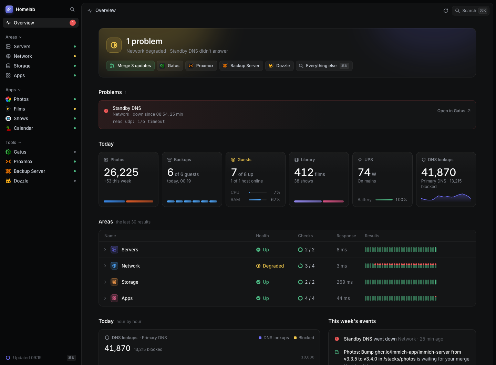

# Overlook

One page that tells you whether your homelab is fine.

[](https://bnlqn.github.io/overlook/)

What's wrong, how each area of the homelab is, and what it did today and
this week, on one page that is the same for every homelab. Overlook reads
the tools you already run, such as Gatus, Proxmox, AdGuard Home, Immich,
Radarr and Sonarr, and changes nothing. [See the demo](https://bnlqn.github.io/overlook/),
drawn from a homelab that doesn't exist.

**Not released yet.** The road below says where it is. The words the
project uses are in [CONTEXT.md](CONTEXT.md) and its decisions in
[docs/adr](docs/adr).

## The road to v0.1

1. [x] The skeleton: the Go server, the strict config, the GET-only client,
       the snapshot, the translation table, the page, the Gatus adapter and
       the contract test.
2. [x] The other adapters, one pull request each: Proxmox VE, Proxmox Backup
       Server, AdGuard Home, Immich, Radarr and Sonarr, NUT, GitHub.
3. [x] The demo from an invented snapshot, this README, CI, and releases
       (amd64 and arm64 binaries, a multi-arch image on GHCR).
4. [x] `v0.1.0-rc.1`, with its image public.
5. [x] The author's homelab runs the release candidate in place of its own
       page.
6. [x] Two sources of one kind told apart: each part names its source
       where another of the same adapter is read, and figures that add up,
       such as two hosts' guests, are one tile split by source.
7. [x] The chores from a to-do list (ADR 0010): the iCalendar adapter in
       place of the config's `chores:`, released as `v0.1.0-rc.3`.

v0.1 is never tagged. Its last two steps, a week on the author's homelab
and going public, moved to the end of the road to v0.2, so that the week
is run with the adapters the author's homelab needs. Its three release
candidates stay as pre-releases.

## The road to v0.2

1. [x] Three homelabs to look at, each an invented snapshot the demo
       serves: the demo's own, a small one (Gatus and two apps) and a
       large one, at the most the page is made for: 12 hosts, 12 people,
       30 sources, 100 checks and 30 apps. Every change to the page is
       looked at with all three.
2. [x] The page at that scale: eight colours for people and sources, the
       rest folded into one share; a section of hosts per source, a row
       each; a check that keeps no recent results; `check:` naming its
       check engine; charts of what hosts measure, a line each. Then the
       large homelab is looked at whole, and what still looks wrong is
       fixed.
3. [x] One login, in `internal/fetch`, for a source that offers no other
       way in (ADR 0009).
4. [x] The adapters for what the author's homelab runs: Beszel, Docker,
       Prowlarr and qBittorrent.
5. [x] The tools most homelabs run, each recorded from a scratch instance
       (ADR 0008), one pull request each, in this order: Jellyfin, Home
       Assistant, Uptime Kuma, Pi-hole, Paperless-ngx, Nextcloud, Grafana,
       Plex through Tautulli, Seerr, and Prometheus with Alertmanager.
6. [x] What Overlook can't read, listed under [Can't be read](#cant-be-read),
       and an issue for each adapter wanted.
7. [x] `v0.2.0-rc.1`, and the author's homelab reads everything it runs
       with it: step 4's adapters, and Home Assistant, whose adapter is
       then recorded again from the author's own (ADR 0008).
8. [ ] A week of running it.
9. [ ] The repository goes public, `v0.2.0` is tagged and the issues for
       the adapters wanted are opened. The demo goes live then: Pages set
       to build from GitHub Actions, and the Demo workflow run once by
       hand, since going public pushes nothing to `main`.

v0.2 is ready when the large homelab looks right at desktop and phone
width, the author's homelab has run it for a week with nothing missing,
the demo is live, every adapter has its section here (its config and the
least key it needs), and CI passes.

## What it shows

- **What's wrong**: the problems, which are the checks your check engine
  alerts on, for as long as they fail. Overlook runs no check and sends no
  alert, so the page and your alerts always agree.
- **How each area is**: Servers, Network, Storage and Apps, each up,
  degraded (a problem, but it still works, such as DNS with one of two
  resolvers down) or down, with its checks' last 30 results and a page of
  its own with what its sources add, such as a host's guests or a
  resolver's top clients.
- **Today**: a figure from each source, such as guests up, DNS lookups,
  photos or what the UPS draws.
- **This week**: each area's problems and events along the last seven days,
  and the list of what happened, as far as your sources remember it.
- **Your apps and tools**, each a link with a dot that says whether it
  answers.
- **The chores**: the ones on your to-do list that are due or come this
  week, the updates waiting for your merge or to be installed, the
  batteries to change and the requests waiting for your approval. You do a
  chore where it waits, such as marking it done on the list, never on the
  page, and a chore is never a problem.

## What it never does

- **It never changes anything.** Overlook sends a source only GET requests,
  and a login where a source offers no other way in, which changes nothing
  but a session; it sends NUT only LIST VAR, which reads. The client it
  reads with refuses every other request. Some keys it holds could do
  anything (AdGuard Home has no read-only users, and Radarr's and Sonarr's
  keys are admin keys), and this is what keeps them harmless. Tautulli
  changes things on GET too, so its adapter sends only the commands that
  read, from a list its test checks (ADR 0011).
- **It never runs a check or sends an alert.** Your check engine does both.
- **It remembers nothing.** No database and no volume: it reads every
  source when the page asks, at most every 30 seconds, so an Overlook
  nobody looks at sends nothing into your homelab. What happened this week
  is what your sources remember.
- **It never sends a key to the browser.** The server reads every source
  and gives the page a snapshot of what it read, never a key or a source's
  own answer.
- **It never asks where to put things.** The page is fixed: your config
  says which sources fill it, never where anything goes. There are no
  widgets to arrange.
- **It never calls anywhere you didn't name.** No telemetry and no update
  check; the page's fonts and icons come from Overlook itself.

## Quick start

Overlook is one container. Put its config in a folder of its own, beside a
`compose.yaml`:

```
overlook/
  overlook.yaml
compose.yaml
.env
```

```yaml
# compose.yaml
services:
  overlook:
    image: ghcr.io/bnlqn/overlook:0.1
    restart: unless-stopped
    ports:
      - "8080:8080"
    volumes:
      - ./overlook:/etc/overlook:ro # the config, read-only: Overlook writes nothing
    env_file: .env                  # the keys
    environment:
      TZ: Europe/Brussels           # when today starts
```

```yaml
# overlook/overlook.yaml
sources:
  gatus:
    - url: http://gatus.example.com:8080
  proxmox:
    - url: https://pve.example.com:8006
      token: overlook@pve!overlook
      secret: ${PROXMOX_SECRET}       # from the environment
      ca: /etc/overlook/pve-root-ca.pem # copied into overlook/

apps:
  - name: Photos
    url: https://photos.example.com
    icon: immich.svg
    check: Photos
```

```sh
# .env: the keys, for your eyes only (chmod 600 .env)
PROXMOX_SECRET=00000000-0000-0000-0000-000000000000
```

Then `docker compose up -d`, and open port 8080 of that host. The log says
which sources Overlook reads, and the page names any that didn't answer.

- **Keys come from the environment.** A `${VAR}` anywhere in the config is
  read from Overlook's environment, so the config holds no secret and can
  be shared or kept in git. A `${VAR}` that isn't set stops Overlook, and
  says which.
- **The config is mounted read-only**, at `/etc/overlook`, with a CA file or
  your own icons beside it. The image runs as uid 65532, so the folder and
  its files must be readable by others, as they are by default.
- **`TZ`** says when today starts, for today's figures. Any zone works: the
  zone database is inside the binary.
- **The image** is `ghcr.io/bnlqn/overlook`, for amd64 and arm64: `0.1` for
  the newest 0.1 release, or a version such as `0.1.0`. It holds the
  binary and the CA certificates it checks HTTPS sources with, and nothing
  else.

Without Docker, each [release](https://github.com/bnlqn/overlook/releases)
has the binary for Linux on amd64 and arm64, such as for an LXC container
or a Raspberry Pi:

```bash
overlook -config /etc/overlook/overlook.yaml -listen :8080
```

## Configuring

[`overlook.example.yaml`](overlook.example.yaml) shows every source with
comments. Overlook reads the config once, at start, and refuses a key it
doesn't know, so a typo stops it rather than going unnoticed.

**Sources.** Under `sources:`, each adapter has a list, so two AdGuard Home
resolvers are two entries under `adguard:`. Each source has a `name`, which
the page uses. Each adapter gives one, such as Gatus, and two sources can't
share one, so two of a kind need names of their own. With two of a kind,
the page names each one's sections, figures and events, and adds up what
adds up, such as two Proxmox hosts' guests, split by source.
What each adapter reads, its config and the least key it needs are under
[Adapters](#adapters) below.

**Areas.** The page has four, always the same: Servers, Network, Storage
and Apps, and an area with nothing in it isn't shown. Each adapter puts
its parts in its own area, such as Proxmox VE in Servers and AdGuard Home
in Network. A check goes in the area its group in the check engine is
named after, or the one the config gives that group, as in Gatus's
`areas:`. A check in no area still counts, and its problems still show.

**Apps and tools.** Apps are what the homelab hosts for the people who use
it; tools are what you run it with. Both are links on the page, in the
sidebar and in ⌘K:

```yaml
apps:
  - name: Photos                     # the only key besides url it needs
    url: https://photos.example.com
    icon: immich.svg                 # a file in overlook/icons/, one Overlook ships, or a URL
    check: Photos                    # the check that lights its dot
    description: The family's photos
    color: "#ED79B5"                 # tints its tile
tools:
  - name: Proxmox
    url: https://pve.example.com:8006
    icon: proxmox.svg
    check: Hypervisor
```

A `check` is a check's name in your check engine. With two check engines
that both have a check of that name, say which, as `Gatus Outside/Photos`;
if you don't, the dot shows the worse of the two, and the log says so once.

Overlook ships icons for a few common apps (`web/icons`); a file of the
same name in `icons/` beside the config wins over one of them.

**Chores** are what you do while nothing is broken: the ones you keep on a
to-do list, which the [iCalendar](#icalendar-to-do-list) source reads; the
updates waiting for your merge, which the [GitHub](#github) source reads;
the updates waiting to be installed, which the
[Home Assistant](#home-assistant) and [Nextcloud](#nextcloud) sources read,
and the batteries to change, from Home Assistant; and the requests waiting
for your approval, which the [Seerr](#seerr) source reads. The page lists
the chores due, from their day on, and those in the coming week, by the
viewer's own calendar; with none, it says which is next. With chores from
more than one source, each is named by the one it waits in. You add, change
and mark chores done in your to-do app or from a script, and do the others
where they wait, never on the page (ADR 0010), and the page follows within
30 seconds.

**Flags.** `-config` names the config (`overlook.yaml` by default), and
`icons/` and `custom.css` are read beside it; `-listen` is the address to
serve the page on (`:8080`).

## Adapters

Each adapter reads one kind of source. More come by pull request from
people who run them ([CONTRIBUTING.md](CONTRIBUTING.md)).

### Gatus

A check engine: every check, its last results and the problems Gatus
remembers. A check is a problem once it fails as many times in a row as
your alerts wait for, and stops being one when it passes.

```yaml
sources:
  gatus:
    - url: http://gatus:8080            # where Overlook reads Gatus
      link: https://status.example.com  # where the page sends you, if not the same
      threshold: 3                      # failures in a row that make a problem: as your alerts
      areas:                            # where a group not named like an area goes
        DNS: network
        Backups: storage
```

**Key:** none, as Gatus's API is open unless you protect it. If yours asks
for a login, as Gatus's `security.basic` does, give it as `user` and
`password`: `user: overlook` and `password: ${GATUS_PASSWORD}`.

**Areas:** a group named like an area, such as Servers or network, puts its
checks there. `areas` says where each other group goes, and a group it
doesn't name is in no area. **Threshold:** set it to your alerts'
`failure-threshold` (3 unless you changed it), so a problem on the page is
one your alerts announced.

### Uptime Kuma

A check engine, as Gatus is: each monitor on one of its status pages, its
last 30 results and the problems they remember. A monitor is a problem once
Uptime Kuma calls it down, after the retries you gave it, which is when it
alerts; while it retries, the page shows it failing.

```yaml
sources:
  uptimekuma:
    - url: http://uptime-kuma:3001     # where Overlook reads Uptime Kuma
      page: homelab                    # the status page's slug, as in /status/homelab
      link: https://uptime.example.com # where the page sends you, if not the same
      areas:                           # where a group not named like an area goes
        DNS: network
```

**Key:** none, as a status page is public: Overlook reads the monitors on the
one you name, and no others. Make one for it in Status Pages, with each
monitor in a group named like an area, such as Servers or Network, or one
`areas` places, as Gatus's groups are. Uptime Kuma gives a monitor's results
only there and over its socket.io, after a login, which Overlook doesn't
speak.

A status page doesn't say why a monitor failed, so the page doesn't either.
Nor does it say how many retries a monitor has: the page counts them from
the last time the monitor went down, in the 100 results a status page keeps,
and for a monitor that hasn't gone down there, it says how many times in a
row it failed, but not how many make a problem.
Uptime Kuma serves a status page's results a minute at a time.

Recorded from a scratch Uptime Kuma 2.5.8 with invented monitors (ADR 0008),
until someone who runs one records it from theirs: the compose file and the
scripts that fill and record it are in the adapter's
[`testdata`](internal/adapters/uptimekuma/testdata).

### Grafana

A check engine, as Gatus is: each alert rule Grafana manages, in the area
its folder is named after, or the one `areas` gives, with its last 30
evaluations and the problems its state history remembers this week. A rule
is a problem once it fires, or while its query gives no data or an error,
which Grafana alerts on too; while it's pending, the page shows it failing,
and how many evaluations its pending period holds.

```yaml
sources:
  grafana:
    - url: http://grafana:3000          # where Overlook reads Grafana
      token: ${GRAFANA_TOKEN}
      link: https://grafana.example.com # where the page sends you, if not the same
      areas:                            # where a folder not named like an area goes
        Hosts: servers
```

**Key:** a service account's token, with the role **Viewer**, which reads
alert rules and their history and changes nothing. In Administration, Users
and access, Service accounts, add one with that role, then add it a token.

Grafana keeps only when a rule's state changed, not each evaluation, so the
page draws each of the last 30 from those changes at the rule group's
interval. Overlook reads each rule's history with a request of its own.
Alert rules kept in a Prometheus or Loki data source, rather than by Grafana
itself, are left out: the [Prometheus](#prometheus-and-alertmanager) adapter
reads Prometheus's own.

Recorded from a scratch Grafana 13.3 with invented alert rules over its own
test data (ADR 0008), until someone who runs one records it from theirs: the
compose file and the scripts that fill and record it are in the adapter's
[`testdata`](internal/adapters/grafana/testdata).

### Prometheus and Alertmanager

A check engine, as Gatus is: each of Prometheus's alerting rules, in the
area its group is named after, or the one `areas` gives, with its last 30
evaluations, from the history Prometheus keeps of its alerts, and its
problems this week. A rule is a problem while it fires; while it's pending,
the page shows it failing, and how many evaluations its `for` holds. With
Alertmanager read too, a rule all of whose alerts Alertmanager silences or
inhibits isn't a problem, since Alertmanager sends no alert for it: the page
shows it failing, with the silence's comment.

```yaml
sources:
  prometheus:
    - url: http://prometheus:9090              # where Overlook reads Prometheus
      alertmanager: http://alertmanager:9093   # its Alertmanager, if any
      link: https://prometheus.example.com     # where the page sends you, if not the same
      areas:                                   # where a rule group not named like an area goes
        node: servers
```

**Key:** none, as Prometheus's and Alertmanager's APIs are open unless you
protect them. If yours ask for a login, as `basic_auth_users` in Prometheus's
web config does, give it as `user` and `password`, the same for both.
Overlook reads the rules, two range queries of the `ALERTS` series and
Alertmanager's alerts and silences, all with GET, which change nothing.

This week's problems are read to five minutes, which a week of firing
alerts holds in a few thousand samples.

Recorded from a scratch Prometheus 3.15 and Alertmanager 0.34 with invented
alert rules over numbers of their own (ADR 0008), until someone who runs
them records it from theirs: the compose file, the rules and the scripts
that fill and record it are in the adapter's
[`testdata`](internal/adapters/prometheus/testdata).

### GitHub

The updates waiting: the open pull requests Dependabot or Renovate opened on
the repositories you list. They are chores, never problems.

```yaml
sources:
  github:
    - repos: [example/homelab, example/website]
      token: ${GITHUB_TOKEN} # only for private repositories
      # bots: ["dependabot[bot]", "renovate[bot]"] # whose pull requests are updates
      # url: https://github.example.com/api/v3     # a GitHub Enterprise Server's API
```

**Key:** none for public repositories. For private ones, a
[fine-grained token](https://github.com/settings/personal-access-tokens/new)
with read-only access to **Pull requests** on those repositories (GitHub adds
**Metadata** itself). Without one, GitHub answers 404 for a private
repository.

Overlook reads GitHub at most every 10 minutes, so an update can take that
long to show. Without a token GitHub allows 60 requests an hour from your
address, and each read is one request per repository: ten repositories hold,
fewer if something else at your address reads GitHub without a token.

### iCalendar to-do list

The chores you keep on a to-do list, read from the iCalendar file a CalDAV
server gives for a GET, such as Radicale, Nextcloud or Baïkal. Edit the list
in any app that syncs it, such as Reminders on an iPhone, Tasks.org with
DAVx⁵ on Android, or Thunderbird, or from a script over CalDAV.

```yaml
sources:
  ical:
    - url: https://dav.example.com/owner/chores/ # the list, as Radicale serves it
      user: owner                                # a login, if the server asks for one
      password: ${DAV_PASSWORD}
      # name: Chores                             # what the page calls it, if you keep more than one list
```

On Nextcloud or Baïkal the `url` is the list's CalDAV address with `?export`
at the end, such as
`https://cloud.example.com/remote.php/dav/calendars/owner/chores/?export`.

A to-do's title is the chore and its description the note. Its due date is
the day it's due from, a time counting as its day, and one with no due date
is due now. One marked done or cancelled leaves the page. A to-do that comes
back is your app's to move on when you mark it done, and Overlook reads only
the next due date.

**Key:** a login that can read the list, as `user` and `password`, sent by
HTTP's basic authentication, or none if the list is open. Overlook only ever
sends it with GET (ADR 0001). The least it needs, on Radicale, is a user of
its own with only `i` on the list, which lets it GET the list and nothing
else. With Radicale's rights from a file (`[rights] type = from_file`), beside
the sections that give each user their own:

```ini
[overlook]
user: overlook
collection: owner/chores
permissions: i
```

Baïkal asks for Digest unless its admin page sets Basic, which Overlook needs.
Recorded from Radicale; Nextcloud and Baïkal give the same iCalendar for
`?export`, but haven't been recorded.

### Immich

The photos, on the Apps page: what each person keeps and uploaded this week,
the space they take on Immich's disk, Immich's version and whether a newer one
is out, and the jobs queued. Today's figure is everyone's photos and videos,
with each person's share of the room they take.

```yaml
sources:
  immich:
    - url: http://immich:2283
      key: ${IMMICH_KEY}
      # name: Photos # what the page calls it, if not Immich
```

**Key:** an API key made by an admin (Account Settings, API Keys), since
Immich shows everyone's photos, the queues and each person's uploads only to
an admin. Give it only these six read permissions:

- `server.statistics`: each person's photos, videos and space
- `server.storage`: the disk the photos are on
- `server.about`: Immich's version
- `server.versionCheck`: the newest version released
- `queue.read`: the jobs queued
- `adminUser.read`: what each person uploaded this week

What each person uploaded needs Immich 3 or later; an older one leaves it out.

### Proxmox Backup Server

Each guest's newest backup in one datastore, in Storage: when it was made,
its size, and whether it passed its check, named by its notes, which
Proxmox VE fills with the guest's name. Today shows how many guests the
last night backed up, each guest blue where it did, and the week each
night's backups. The last night is
the run with the most guests in the day to the newest backup, so a guest
backed up by hand after it doesn't hide it.

```yaml
sources:
  pbs:
    - url: https://pbs.example.com:8007
      token: overlook@pbs!overlook
      secret: ${PBS_SECRET}
      datastore: backups
      ca: /etc/overlook/pbs.pem         # PBS's own certificate, copied from the server
      # server_name: pbs.example.com    # the name it's for, if the url uses another
```

**Key:** an API token with the role **DatastoreAudit** on that datastore,
which lists the backups and can't read them. A token can do no more than
its user, so both get the role. On the server:

```bash
proxmox-backup-manager user create overlook@pbs
proxmox-backup-manager acl update /datastore/backups DatastoreAudit --auth-id overlook@pbs
proxmox-backup-manager user generate-token overlook@pbs overlook
proxmox-backup-manager acl update /datastore/backups DatastoreAudit --auth-id 'overlook@pbs!overlook'
```

The third command prints the token's secret.

**Certificate:** PBS signs its own, for its own name. Copy
`/etc/proxmox-backup/proxy.pem` from the server beside Overlook and name it
as `ca`. If the `url` reaches PBS by an address its certificate doesn't
name, give the name it does as `server_name`. As for Proxmox VE, there is
no way to skip the check.

### Proxmox VE

Each host's processor, memory, uptime and version, the guests, the storage,
the ZFS pools and the last backup run, in Servers, with each host's
processor and memory by the hour over the week Proxmox keeps, a line each.
Today shows how many guests are up, and the week each backup run.

```yaml
sources:
  proxmox:
    - url: https://pve.example.com:8006 # any host of a cluster reads all of it
      token: overlook@pve!overlook
      secret: ${PROXMOX_SECRET}
      ca: /etc/overlook/pve-root-ca.pem  # Proxmox's own CA, copied from the host
```

**Key:** an API token of a user with the role **PVEAuditor**, which reads
everything and changes nothing. On the host:

```bash
pveum user add overlook@pve
pveum acl modify / --users overlook@pve --roles PVEAuditor
pveum user token add overlook@pve overlook --privsep 0
```

The last command prints the token's secret. The user has no password, so
the token is the only way in, and it can do no more than the user.

**Certificate:** Proxmox signs its own. Copy `/etc/pve/pve-root-ca.pem` from
the host beside Overlook and name it as `ca`: Overlook then trusts that CA
alone for this source. There is no way to skip the check, since a key sent
to whoever answers in Proxmox's place is given away. A host with a
certificate from a public CA, such as Let's Encrypt, needs no `ca`.

### Radarr

The films on disk and the room they take, the films added this week, what
Radarr is downloading and warns about, and the films out to stream or on
disc in the next seven days. Its home area is Apps. With Sonarr read too, the
films and shows share one tile in Today, the library, split by the room each
takes.

```yaml
sources:
  radarr:
    - url: http://radarr:7878 # where Overlook reads Radarr
      key: ${RADARR_KEY}
      name: Radarr            # if you run more than one, tell them apart
```

**Key:** Radarr's API key, from Settings, General. It's the only key Radarr
has, and it can do anything, but Overlook sends it only with GET requests,
which change nothing (ADR 0001).

Radarr answers with every film at once, so Overlook reads the films at most
every 10 minutes, and a film can take that long to count. The rest is read
with every snapshot.

### Sonarr

The shows and episodes on disk and the room they take, the episodes imported
this week, what Sonarr is downloading and warns about, and the episodes that
air in the next seven days. Its home area is Apps. With Radarr read too, its
shows share the library's tile with the films.

```yaml
sources:
  sonarr:
    - url: http://sonarr:8989 # where Overlook reads Sonarr
      key: ${SONARR_KEY}
      name: Sonarr            # if you run more than one, tell them apart
```

**Key:** Sonarr's API key, from Settings, General. Like Radarr's, it's the
only key and it can do anything, and Overlook sends it only with GET requests
(ADR 0001).

The shows are read at most every 10 minutes, as Radarr's films are.

### NUT

A UPS, read from NUT's upsd over NUT's own protocol. Servers shows whether it
runs on mains or on its battery, its model and the voltage it's fed, the
battery's charge and how long it would last, and what its load draws; the
overview shows the draw and the battery.

```yaml
sources:
  nut:
    - host: nut.example.com # upsd, as host or host:port (3493 unless you say)
      ups: ups              # the UPS's name in upsd, as in its ups.conf
```

upsd needs no login for this: Overlook sends only `LIST VAR` for the UPS
named, and has no code to send any other command.
upsd must listen where Overlook can reach it, which by default it doesn't:
set `MODE=netserver` in `nut.conf`, add a `LISTEN` line for the address
Overlook reaches to `upsd.conf` (such as `LISTEN 192.0.2.13 3493`), and let
Overlook through any firewall to that port. The readings cross the network
unencrypted, as upsd sends them without TLS.

### AdGuard Home

Each resolver is its own source. Today's lookups and blocks show on the
Overview, every resolver's added up, hour by hour. The Network page charts
them by the hour over the hours every resolver keeps, added up too, then shows
each one: whether it filters, its lookups, blocks and upstreams, and its top
clients, domains and blocked domains, over the interval its statistics keep.

```yaml
sources:
  adguard:
    - name: Primary DNS
      url: http://dns1.example.com
      user: overlook
      password: ${ADGUARD_PASSWORD}
    - name: Standby DNS
      url: http://dns2.example.com
      user: overlook
      password: ${ADGUARD_PASSWORD}
```

**Key:** a login, as `user` and `password`. AdGuard Home has no
read-only users, so that login could change anything; what keeps it
harmless is that Overlook only ever sends GET (ADR 0001). Give Overlook a
user of its own: add it under `users:` in `AdGuardHome.yaml`, with its
password hashed by `htpasswd -B -C 10 -n -b overlook <password>`, and
restart AdGuard Home.

**Today** starts at midnight in Overlook's time zone: set `TZ`, such as
`TZ=Europe/Brussels`, in its container. AdGuard Home keeps statistics by
the hour for an interval of up to 7 days; over a longer one it keeps them
by the day, in UTC, and the Overview shows no figure for it.

### Pi-hole

A resolver, as AdGuard Home is: each one is its own source, and its lookups
add up with every other resolver's, AdGuard Home's too, on the Overview and
in the Network page's chart, hour by hour over the last day, which is all
Pi-hole keeps in memory, so beside a resolver that keeps a week, the chart
shows the day they both have. Then each one: whether it blocks, or is paused and
until when, its lookups and blocks, its blocklists and when they were last
updated, its upstreams, what it warns about, such as a client it
rate-limits, its version and whether a newer one is out, and its top
clients, domains and blocked domains.

```yaml
sources:
  pihole:
    - name: Kids' DNS
      url: http://pihole.example.com
      password: ${PIHOLE_PASSWORD}
```

**Key:** an app password, from Settings, Web interface / API, in expert
mode: **Configure app password**. Pi-hole gives a session only for a login,
so Overlook logs in with one POST, keeps the session in memory and sends it
with each GET, logging in again only when Pi-hole forgets it (ADR 0009). An
app password logs in without the second factor, if you set one, and Pi-hole
has no read-only one, so it could change anything; what keeps it harmless is
that Overlook sends nothing else. With no password set in Pi-hole, leave
`password` out. Each Overlook keeps one of the sessions Pi-hole allows, 16
unless you changed `webserver.api.max_sessions`.

Recorded from a scratch Pi-hole 2026.10 with invented clients and domains
(ADR 0008), until someone who runs one records it from theirs: the compose
file and the scripts that fill and record it are in the adapter's
[`testdata`](internal/adapters/pihole/testdata).

### Beszel

Each system Beszel's agents report on, as a host, in Servers: how long it
has been up, its threads and load, and how busy its processor and how full
its memory and disk are, or since when it's down. Its processor and memory
by the hour, over the week Beszel keeps, are a line each on the same charts
as any other source's hosts, such as Proxmox's. Today shows the hosts up,
every hub's added up.

```yaml
sources:
  beszel:
    - url: http://beszel:8090         # where Overlook reads the hub
      user: overlook@example.com      # its user's email
      password: ${BESZEL_PASSWORD}
```

**Key:** a login, as `user` and `password`, since Beszel has no API keys.
Overlook logs in with one POST, keeps the session in memory and sends it
with each GET, logging in again when Beszel forgets it (ADR 0009). The least
it needs is a user of its own with the role **readonly**, which can change
nothing, nor read the agents' keys. As a superuser, in the hub's admin page
at `/_/`, add the user to the `users` collection with `role` set to
`readonly`, then add it to the `users` of each system to show, or set
`SHARE_ALL_SYSTEMS=true` on the hub so that every user sees every system.

### Docker

Each container a Docker engine runs, in Servers: its image, and whether it
runs, those that exited with an error, restart or fail their health check
in red or orange, and one that exited cleanly, as a job does when it's
done, in grey. Today shows the containers running, every engine's added up.

```yaml
sources:
  docker:
    - url: http://socket-proxy:2375 # Docker's API, through a socket proxy
      name: Media                   # if you run more than one engine, tell them apart
```

**Key:** none, as Docker's API has no login and no read-only access:
whoever reaches its socket is root on the host, even through a socket
mounted read-only. So Overlook reads it only through a socket proxy that
lets the containers' reads through and refuses the rest, over HTTP: it has
no way to read Docker's socket itself, nor Docker's API over TLS. With
[linuxserver's socket proxy](https://docs.linuxserver.io/images/docker-socket-proxy/),
beside the containers on each host:

```yaml
services:
  socket-proxy:
    image: lscr.io/linuxserver/socket-proxy:3.4.7
    environment:
      CONTAINERS: "1" # the containers' reads; every write stays refused
    volumes: ["/var/run/docker.sock:/var/run/docker.sock:ro"]
    read_only: true
    tmpfs: [/run]
    ports: ["2375:2375"] # where Overlook reaches it: keep it from anyone else
```

Overlook reads only the list of containers, never a container's own
details, which hold its environment and so its keys.

### Prowlarr

Each indexer, on the Apps page: whether it's enabled, those Prowlarr leaves
out because they fail, in red with since when, and what each was asked and
grabbed this week; and what Prowlarr warns about.

```yaml
sources:
  prowlarr:
    - url: http://prowlarr:9696 # where Overlook reads Prowlarr
      key: ${PROWLARR_KEY}
```

**Key:** Prowlarr's API key, from Settings, General. Like Radarr's, it's the
only key and it can do anything, even read each indexer's own key, and
Overlook sends it only with GET requests (ADR 0001).

### qBittorrent

The torrents, on the Apps page: how many download and seed and how fast,
the room left on qBittorrent's disk, whether peers can reach it, and each
torrent in error, with where it's saved. Today shows the torrents
downloading, every qBittorrent's added up.

```yaml
sources:
  qbittorrent:
    - url: http://qbittorrent:8080 # where Overlook reads its web UI
      key: ${QBITTORRENT_KEY}
```

**Key:** from qBittorrent 5.2, an API key, from Options, WebUI. It can do
anything the web UI can, and Overlook sends it only with GET requests
(ADR 0001). Before 5.2 there are no keys: give the web UI's login as `user`
and `password` instead, and Overlook logs in with one POST, keeps the
session in memory and sends it with each GET, logging in again only when
qBittorrent forgets it (ADR 0009). A wrong password is tried once a read,
so qBittorrent bans Overlook's address after five, for an hour unless you
changed it. With neither, qBittorrent must let Overlook in without a login,
as its bypass for whitelisted subnets does for Overlook's address.

The list of every torrent, which gives the counts and the room left, is
megabytes for a thousand torrents, so Overlook reads it at most every 10
minutes. The speeds, the connection and the torrents in error are read with
every snapshot.

### Jellyfin

The films, shows and music, on the Apps page: what each person plays now
and how, as it is, transcoded or paused; how many films, shows, albums and
books there are; the room left on each disk the libraries are on; the failed
logins of the last day; and each task whose last run failed, such as a
library's scan, in red with why. Today shows the plays since midnight, hour
by hour, every Jellyfin's added up.

```yaml
sources:
  jellyfin:
    - url: http://jellyfin:8096 # where Overlook reads Jellyfin
      key: ${JELLYFIN_KEY}
```

**Key:** an API key, from the dashboard's API Keys. It's the only kind
Jellyfin makes, and it can do anything an administrator can, but Overlook
sends it only with GET requests, which change nothing (ADR 0001).

Recorded from a scratch Jellyfin 12.4 filled with invented films and people
(ADR 0008), until someone who runs one records it from theirs: the compose
file and the scripts that fill and record it are in the adapter's
[`testdata`](internal/adapters/jellyfin/testdata).

### Plex, through Tautulli

Plex, on the Apps page, as Tautulli watches it: what each person plays now
and how, as it is, transcoded or paused, and the bandwidth it takes, of it
to remote players; each library, by what it holds; whether a newer Plex is
out, when Tautulli knows; and, in red, a Plex server Tautulli can't reach.
Today shows the plays since midnight, hour by hour, every media server's
added up, Jellyfin's too.

```yaml
sources:
  tautulli:
    - url: http://tautulli:8181 # where Overlook reads Tautulli, directly
      key: ${TAUTULLI_KEY}
      # name: Plex              # what the page calls it, if not Plex
```

**Key:** Tautulli's API key, from Settings, Web Interface, with the API on.
It's the only key Tautulli has, and it can change Tautulli **even through a
GET**: every command of Tautulli's API is one, such as
`delete_all_history`, so the GET-only client can't keep this key harmless.
What does is that the adapter sends only five commands, each of which
reads, from one list in its code that its test checks (ADR 0011). Tautulli
takes the key only in the address, so a proxy in front of it may log the
key: let Overlook reach Tautulli directly, as above.

Recorded from a scratch Tautulli 2.18 watching a scratch Plex 1.43, with
invented films and plays (ADR 0008), until someone who runs one records it
from theirs: the compose file and the scripts that fill and record it are
in the adapter's [`testdata`](internal/adapters/tautulli/testdata).

### Seerr

The requests for films and shows, on the Apps page: how many wait for your
approval, how many are on their way and how many are there, the problems
people reported that are still open, in orange, and whether a newer Seerr
is out or it waits for a restart. Each request waiting for approval is a
chore, from the day it was made, by its title and who asked, a link to its
page in Seerr, where you approve or decline it.

```yaml
sources:
  seerr:
    - url: http://seerr:5055             # where Overlook reads Seerr
      key: ${SEERR_KEY}
      link: https://requests.example.com # where the page sends you, if not the same
```

**Key:** Seerr's API key, from Settings, General. It's the only key Seerr
has, and it can do anything an administrator can, approving requests too,
but Overlook sends it only with GET requests, which change nothing
(ADR 0001).

A request names its film only by its number on TMDB, so Overlook reads each
title once from Seerr and keeps it, a title never changing; the 20 newest
requests waiting are listed.

Recorded from a scratch Seerr 3.5 with invented people asking for
public-domain films (ADR 0008), until someone who runs one records it from
theirs: the compose file and the scripts that fill and record it are in the
adapter's [`testdata`](internal/adapters/seerr/testdata).

### Home Assistant

The home, on the Apps page: Home Assistant's version, or whether it started
in safe or recovery mode; its automations, those that ran today and those
whose config it couldn't load, which never run, in red; and each device that
dropped off, the newest first. The updates it waits to install are chores,
each a link to its page of updates, as are the batteries below 20%.

```yaml
sources:
  homeassistant:
    - url: http://homeassistant:8123   # where Overlook reads Home Assistant
      token: ${HOMEASSISTANT_TOKEN}
      link: https://home.example.com   # where the page sends you, if not the same
```

**Key:** a long-lived access token of a user of Overlook's own that isn't an
administrator. As an administrator, add the user in Settings, People, Users,
with **Administrator** off; then log in as it, and make the token in its
profile's Security tab. A user that isn't an administrator can still use
every device, such as unlocking a door, with a POST, but Overlook sends only
GET requests, which change nothing (ADR 0001). It reads `/api/config` and
`/api/states`, which `default_config` turns on.

### Paperless-ngx

The documents, on the Apps page: how many Paperless-ngx keeps and how many
wait in its inbox, the room left on its disk, each part it runs on that
isn't well, such as its search index or its task queue, as it words why,
and each document it failed to take in, in red with why, until it's
dismissed in Paperless-ngx. Today shows the documents and the inbox.

```yaml
sources:
  paperless:
    - url: http://paperless:8000 # where Overlook reads Paperless-ngx
      token: ${PAPERLESS_TOKEN}
```

**Key:** the API token of a user of Overlook's own, which sees no document.
Paperless-ngx shows the parts' health and everyone's failed tasks only to
staff, so as a superuser, in Settings, Users & Groups, add a user with
**Admin** on and **Superuser** off, and give it only two permissions: View
on tasks and View on global statistics (`view_paperlesstask` and
`view_global_statistics`). Then make its token, as the user, from its
profile, or with
`curl -X POST -d username=overlook -d password=… https://paperless.example.com/api/token/`.
It can see no document and change nothing, and Overlook sends it only with
GET requests.
Overlook asks for the API's version 10, so that a newer Paperless-ngx answers
it the same way.

Recorded from a scratch Paperless-ngx 3.3.4 filled with invented letters
(ADR 0008), until someone who runs one records it from theirs: the compose
file and the scripts that fill and record it are in the adapter's
[`testdata`](internal/adapters/paperless/testdata).

### Nextcloud

The files, on the Apps page, from Nextcloud's serverinfo app: how many files
there are, of how many people, and how many used Nextcloud since yesterday;
the shares, by link and without a password; the room left and the
database's size; and its version, whether a newer one is out, or, in red,
whether it's in maintenance. Each app waiting for an update is a chore, a
link to Nextcloud's page of updates. Today shows the files, and who used it.

```yaml
sources:
  nextcloud:
    - url: http://nextcloud             # where Overlook reads Nextcloud
      token: ${NEXTCLOUD_TOKEN}
      link: https://cloud.example.com   # where the page sends you, if not the same
```

**Key:** serverinfo's own token, which reads serverinfo's answer and nothing
else, not even a file. Serverinfo ships with Nextcloud; set its token with
`occ`, as Nextcloud's own user:

```bash
occ config:app:set serverinfo token --value "$(openssl rand -hex 24)"
occ config:app:get serverinfo token
```

The counts are Nextcloud's background jobs', so they move as often as its
cron runs, every five minutes if you set it up so.

Recorded from a scratch Nextcloud 35.0.2 with invented people and files
(ADR 0008), until someone who runs one records it from theirs: the compose
file and the scripts that fill and record it are in the adapter's
[`testdata`](internal/adapters/nextcloud/testdata).

### Can't be read

These tools can't be read the way Overlook reads, with GET (ADR 0001), one
login (ADR 0009) and, for a source that changes things on GET, a fixed list
of reads (ADR 0011), or are left out on purpose. Each names the decision it
runs into, and none gets an adapter until that changes:

- **Backrest and restic**: restic has no API, every call to Backrest's is a
  POST, and its metrics say how the last backup went, not when (ADR 0001).
- **Caddy**, on purpose: its admin API has no login, and its only lock is a
  TLS client certificate, so opening it to Overlook opens it to anyone there
  to rewrite Caddy's config (ADR 0001).
- **Deluge, Transmission, Komodo and Zabbix**: every read is a POST
  (ADR 0001).
- **Dockge**: it speaks only socket.io (ADR 0001).
- **Plex on its own**, on purpose: its token is your whole Plex account,
  other servers and friends too, so Overlook reads Plex through
  [Tautulli](#plex-through-tautulli) (ADR 0011).
- **Synology DSM**: its only documented login is a GET with the password in
  the address, where logs keep it, and how to read its health isn't
  documented (ADR 0009).
- **TrueNAS**: TrueNAS 27 removes the REST API, which leaves only a
  WebSocket (ADR 0001).
- **Unbound**: its statistics come only from `unbound-control`, over TLS
  with a client certificate, or on the same machine (ADR 0001).
- **Vaultwarden**, on purpose: reading more than its version takes the
  admin token, which can delete every user (ADR 0009).

Others are left out for a reason of their own:

- **Dozzle and Authelia**: they show nothing more than whether they answer,
  which a check already says.
- **Readarr**: retired in June 2025.
- **Watchtower**: no longer kept, and archived in December 2025.

## No login

Overlook has no accounts and no login: anyone who can open the page sees
all of it. It never shows a key, but it does show your hosts, names and
what is wrong. Keep it on your LAN or behind your VPN, or put it behind
your reverse proxy's own authentication, such as forward auth to your
identity provider.

## Your own look

A `custom.css` beside the config is loaded after the page's own
stylesheet, so it can change any colour, size or font:

```css
/* overlook/custom.css */
:root {
  --m-accent-2: #3cad4b;   /* the accent, green */
  --m-content-max: 1400px; /* a wider page */
}
```

The page's colours, sizes and fonts are the `--m-` properties at the top
of [`web/style.css`](web/style.css). The page stays one page: custom.css
changes how it looks, not what it shows.

## Translating

The page speaks the language of your browser when someone has translated
it, and English for any word a translation lacks. A translation is one
file; [CONTRIBUTING.md](CONTRIBUTING.md#translating) says how.

## Contributing

[CONTRIBUTING.md](CONTRIBUTING.md) says how to set up, what every change
passes and how to add an adapter. Report a vulnerability privately, as
[SECURITY.md](SECURITY.md) explains.

## Licence

Overlook is under the [MIT licence](LICENSE). The page ships the Inter
font, under the SIL Open Font License ([`web/fonts`](web/fonts)), and logos
of common apps, under the Apache License 2.0
([`web/icons`](web/icons)), each logo its owner's trademark.
