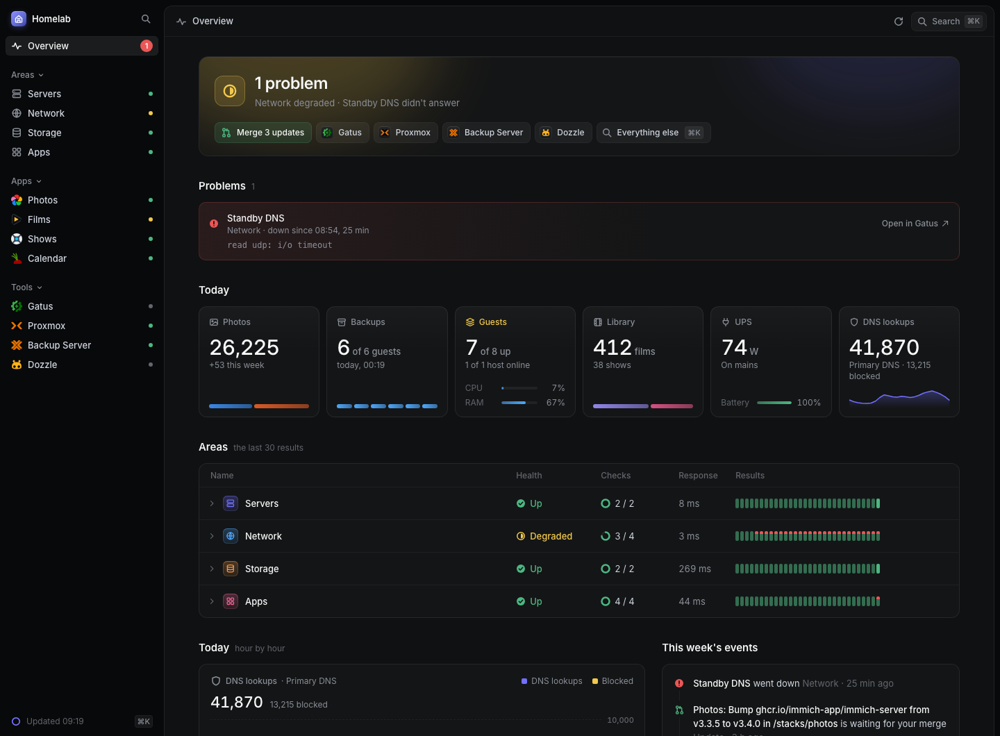

# Overlook

Your whole homelab on one page, laid out for you: what is wrong, how each
area of it is, and what it did today and this week, read from the tools it
already runs, such as Gatus, Proxmox, AdGuard Home, Jellyfin, and Home
Assistant itself. Overlook only reads, and changes nothing.

It opens in Home Assistant's sidebar. With no config yet, it shows its setup
page: pick the tools you run, try each one, and save the two files it hands
back in its folder. The Documentation tab says how.

[Overlook on GitHub](https://github.com/bnlqn/overlook)
